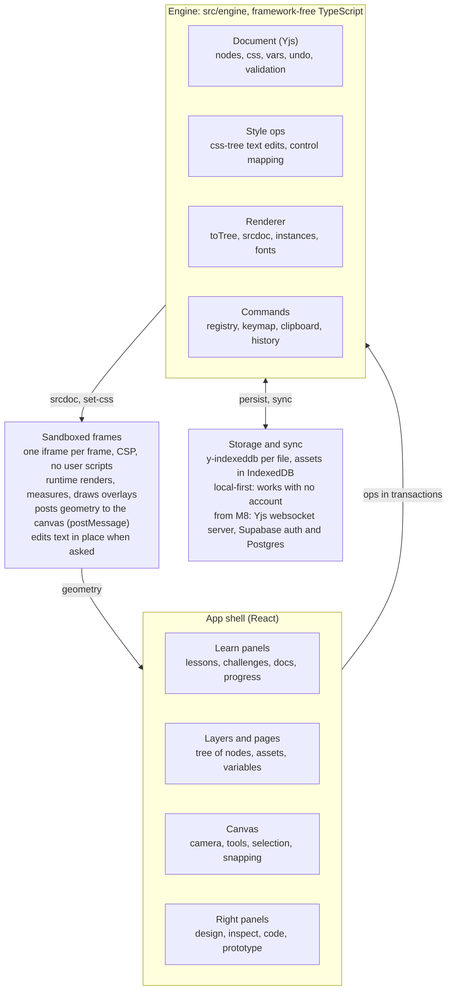
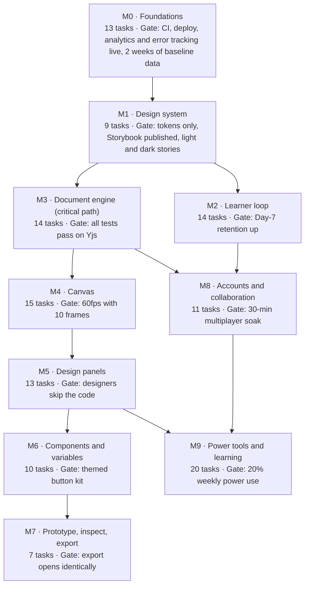

<!-- Exported 2026-11-09 from the Claude Doc "Layout Lab Design Studio — Agent-Ready Build Plan" (https://claude.ai/artifact/Y5t7D2TdLEUpciYchWtCm5). This file is now the copy agents build from; keep it in sync and tick tasks here as they merge. -->

# Layout Lab Design Studio — Agent-Ready Build Plan

2026-11-08 · @MD ISMAIL HOSSAIN

This plan turns Layout Lab Studio from a CSS learning sandbox into a CSS-native design tool, where every visual edit writes real CSS. It merges the earlier [Improvement Plan](https://claude.ai/artifact/F6M6vhSce2W9K6NiMKrjEe) with a full design-tool spec, and breaks all work into 126 numbered tasks an AI coding agent can build one at a time.

## How to use this plan

**For you (the owner):**

1. Export this doc as Markdown and commit it to the repo as `docs/PLAN.md`.
2. Copy the AGENTS.md block from the Agent playbook section into `AGENTS.md` at the repo root.
3. Give the agent one task at a time with the prompt template in the playbook, in ID order within each milestone. Review and merge each pull request before starting the next task.
4. Tick the task's checkbox here (or in `docs/PLAN.md`) when it merges.

**For the agent:**

- Task IDs look like `LL-104`. The first digit is the milestone: `LL-0xx` is M0, `LL-1xx` is M1, up to `LL-9xx` for M9.
- Every task lists **Depends on**, **Size** (S under half a day, M 1–2 days, L 3–5 days), **Files**, **Do**, **Done when** (acceptance criteria) and **Tests**. Do not start a task whose dependencies are not merged.
- Sections 2–7 are the specification. When a task says "per the spec", read the matching section first.
- If the spec and the code disagree, the code is the truth for current behaviour; stop and ask before changing a spec decision.

**Order:** M0 and M1 first (foundation and tokens). M2 can ship to learners while M3–M5 build the design engine. M6–M9 follow. The Milestones drawing shows the gates.

## Vision: a CSS-native design tool

Build the design tool where the canvas *is* the browser: frames are real web pages, auto layout *is* flexbox and grid, variables *are* CSS custom properties, and the code panel shows exactly what the design is. That is the one thing Figma cannot be, and it fits Layout Lab's purpose of teaching CSS.

**Why this works.** Figma's auto layout already follows the flexbox model: direction, gap, padding and alignment map one-to-one to flex properties ([auto layout guide](https://www.resumelens.org/blog/figma/figma-auto-layout-deep-dive)). Penpot, the open-source design tool, went further and builds layouts with real CSS Flexbox and Grid so design and code follow the same rules ([Smashing Magazine](https://smashingmagazine.com/2023/06/penpot-flex-layout-building-css-layouts-design-tool)). Layout Lab already has the hard parts Penpot needed: a sandboxed live renderer, a CSS parser, overlays that draw flex and grid, and measurement of every element.

**One document, three modes.**

| Mode | Who it's for | What they see |
|---|---|---|
| Learn | Beginners | Today's lessons, challenges and docs, now with grading, progress and a CSS echo for every visual change |
| Design | Designers and developers | Infinite canvas, frames at any size, tools, layers, design panel, components, variables, prototype |
| Code | Developers and power users | Tree or HTML, CSS editor, cascade view, Emmet, command palette, export |

All three edit the same document. Switching mode never converts anything.

**What we keep from today:** the typed element tree and HTML generator, the security model (sandboxed iframe, CSP, no injected user HTML), the frame runtime and overlays, the CSS lint and layout hints, all 123 examples, 36 challenges and 83 docs, and the test discipline.

**What is new:** a document engine (pages, frames, components, variables) on Yjs, an infinite canvas with direct manipulation, a design panel that writes CSS, components with variants, variables with modes, prototype links, inspect and export, accounts and real-time collaboration.

**Non-goals for this plan:** a vector illustration tool (pen tool, boolean shape operations), a WebGL renderer, importing `.fig` files, and running learner JavaScript. Each could come later; none is needed for the vision.

## Key decisions (ADRs)

Twelve decisions fix the shape of everything else; an agent must not change one without a written ADR update approved by the owner. Store each as `docs/adr/NNN-title.md` (LL-002).

| # | Decision | Choice | Why | Rejected |
|---|---|---|---|---|
| ADR-1 | Renderer | Real DOM in sandboxed iframes, one iframe per frame (artboard) | The design is real CSS; media queries resolve per frame width; reuses today's renderer and CSP | WebGL/canvas renderer (would re-implement CSS layout); one iframe for all frames (media queries would see one width) |
| ADR-2 | Input on the canvas | Parent handles all pointer input; frames get `pointer-events: none` in Design mode; hit-testing uses geometry the frame runtime reports | One input system across frames; frames stay sandboxed | Event handling inside each iframe |
| ADR-3 | Style source of truth | One CSS text per document (`Y.Text`). The design panel edits it through a style-ops module (css-tree) that applies minimal text edits | Code view and design panel can never disagree; hand-written CSS, comments and order survive | Style objects serialised to CSS (loses hand-written CSS) |
| ADR-4 | Document store | Yjs: nodes in a `Y.Map` keyed by id; each node stores `parentId` + fractional `index`; `Y.UndoManager` for undo; `y-indexeddb` offline; websocket provider later. Zustand keeps only UI/session state | Undo, offline and multiplayer from one model. Figma also stores the parent link on the child, which avoids an object having two parents ([Figma multiplayer post, archived](https://madebyevan.com/figma/)) | Zustand + zundo (no path to collaboration); Automerge (no first-class CodeMirror binding) |
| ADR-5 | Canvas engine | Custom: React, CSS transforms on a world layer, SVG overlay for handles and guides | Frames are iframes, which no canvas SDK models; full control | tldraw SDK: production needs a licence key and commercial use needs a commercial licence ([tldraw](https://tldraw.dev/sdk-features/license-key)) |
| ADR-6 | Shapes | Shapes are elements: Frame = `div`/`section` with fixed size, Rectangle = `div`, Ellipse = `div` + `border-radius: 50%`, Text = `p`/`h1`–`h6`/`span`, Image = `img`, Line = `hr` | Everything stays HTML + CSS that learners can read | SVG shapes in v1 (later, as sanitised inline `svg`) |
| ADR-7 | Class policy | Each styled node has a primary class. Visual edits write to it. If the class is shared, the panel asks "Edit all N" or "Make unique" (adds a new class) | Keeps CSS reusable and readable, never inline `style` | Inline styles per node (unreadable, untaught) |
| ADR-8 | Security | Unchanged invariants: markup only from the typed tree, no user scripts, CSP stays. Images come from IndexedDB as `data:` URLs (`img-src data: https:` already allowed); fonts as `data:` (`font-src data:` already allowed); prototype behaviour from typed data run by our runtime | The preview's safety is the product's foundation | Allowing `blob:` or user JS |
| ADR-9 | Backend | Local-first; the app works fully without an account. At M8: Supabase (auth, Postgres, storage) + a Yjs websocket server (Hocuspocus or y-sweet), picked in spike LL-801 | Ships value before any server exists | Server-first architecture |
| ADR-10 | Code layout | One Vite app. New framework-free code in `src/engine/` (unit-tested TypeScript, no React). Tokens in `src/design/`. A `server/` package via npm workspaces at M8 | Engine logic is testable without a browser | Monorepo now (premature) |
| ADR-11 | Tokens | DTCG-format JSON in `src/design/tokens/`, built to CSS variables; Tailwind v4 `@theme`. Figma imports DTCG tokens too ([Figma help](https://help.figma.com/hc/en-us/articles/15343816063383)) | One token source for app chrome and user variables export | Tailwind JS config |
| ADR-12 | Routing | TanStack Router (type-safe params) | Deep links to lessons, challenges, files, shares | Hash-only state |

## Architecture

The UI never edits data directly: every change is an engine op inside a Yjs transaction, and frames are pure renderers that report measurements back.


*The parent app owns input and data; sandboxed frames only render and measure.*

The line on the left is the geometry channel: frames post element rectangles to the canvas, which does all hit-testing and drawing of handles (ADR-2). Folder layout after M5:

```text
src/
  app/commands/        command registry, keymap (LL-314)
  design/              tokens (LL-102)
  engine/              framework-free TypeScript
    model/             types, validate, zod schemas (LL-301)
    doc/               Yjs store, ops, history (LL-302, LL-307)
    adapters/          sandbox <-> document, content (LL-303)
    persist/           IndexedDB, migration, cloud (LL-304, LL-804)
    style/             css-tree parse, query, edit, scopes (LL-310, LL-311)
    mapping/           design controls <-> CSS (LL-501)
    render/            toTree, frame srcdoc (LL-309)
    import/            HTML sanitise + convert (LL-313)
    variables/ components/ prototype/ assets/ fonts/ canvas/
    react/             hooks binding Yjs to React (LL-305)
  features/            UI by feature (canvas, design-panel, layers, tree, editor, preview, ...)
  components/          ui primitives, inspector controls, patterns (M1)
  routes/              home, play, design, present, files, gallery
server/                from M8 (LL-802)
```

## Document model spec

One `Y.Doc` per file holds pages, frames, nodes, one stylesheet, variables, components, assets and prototype links. Today's sandbox (`items` + `css`) becomes a document with one page and one frame, so all existing content keeps working (LL-303). Implement these types in `src/engine/model/types.ts` exactly; change them only through an ADR.

```ts
// src/engine/model/types.ts
import type { TagName } from '@/types/tree'

export type NodeId = string // nanoid; must match /^[a-zA-Z][a-zA-Z0-9_-]{0,63}$/ (same as today)

/** Y.Doc layout (top-level shared types):
 *  meta: Y.Map            -> DocumentMeta
 *  nodes: Y.Map<Y.Map>    -> NodeId -> node fields (one Y.Map per node)
 *  css: Y.Text            -> the stylesheet; single source of truth for styles (ADR-3)
 *  variables: Y.Map       -> collectionId -> VariableCollection
 *  components: Y.Map     -> componentId -> ComponentDef
 *  assets: Y.Map          -> assetId -> AssetMeta (bytes live in IndexedDB store 'assets')
 *  prototype: Y.Map       -> linkId -> PrototypeLink
 */
export interface DocumentMeta {
  schemaVersion: 2
  id: string
  name: string
  kind: 'sandbox' | 'challenge' | 'design'
  challengeId?: string
  createdAt: number
  updatedAt: number
}

export type NodeKind = 'page' | 'frame' | 'element' | 'image' | 'instance'

interface BaseNode {
  id: NodeId
  kind: NodeKind
  parentId: NodeId | null // the child stores its parent (ADR-4)
  index: string // fractional index among siblings (package: fractional-indexing)
  name: string // layer name shown in the Layers panel
  visible: boolean
  locked: boolean
}

export interface PageNode extends BaseNode {
  kind: 'page'
  parentId: null
  canvasColor: string
}

/** A frame is an artboard: its own iframe, viewport = width x height. */
export interface FrameNode extends BaseNode {
  kind: 'frame'
  parentId: NodeId // a page
  x: number // canvas position only, never written to CSS
  y: number
  width: number // iframe viewport width (drives media queries)
  height: number | 'auto' // 'auto' = grows to content
  tag: TagName // the frame's root element
  classes: string[]
  attrs: Record<string, string>
  modes: Record<string, string> // collectionId -> modeId, emitted as data-mode-* on <html>
  background: 'white' | 'dark' | 'checker' | 'transparent'
}

export interface ElementNode extends BaseNode {
  kind: 'element'
  tag: TagName
  classes: string[]
  text: string
  attrs: Record<string, string> // whitelist as in src/features/tree/tags.ts
}

export interface ImageNode extends BaseNode {
  kind: 'image'
  tag: 'img'
  classes: string[]
  attrs: Record<string, string> // alt etc.
  source: { kind: 'asset'; assetId: string } | { kind: 'url'; url: string } | { kind: 'placeholder' }
}

export interface InstanceNode extends BaseNode {
  kind: 'instance'
  componentId: string
  variant: Record<string, string> // axis -> value
  overrides: Override[]
  classes: string[] // extra classes on the instance root
}

export type Override =
  | { target: NodeId; field: 'text'; value: string } // target = node id inside the main component
  | { target: NodeId; field: 'attr'; key: string; value: string }
  | { target: NodeId; field: 'visible'; value: boolean }
  | { target: NodeId; field: 'swap'; componentId: string }

export type DesignNode = PageNode | FrameNode | ElementNode | ImageNode | InstanceNode

export interface VariableCollection {
  id: string
  name: string // e.g. 'Theme'
  modes: { id: string; name: string }[] // e.g. Light, Dark
  defaultModeId: string
  variables: Variable[]
}

export interface Variable {
  id: string
  name: string // 'color/brand/primary'
  cssName: string // '--color-brand-primary' (derived, unique)
  type: 'color' | 'dimension' | 'number' | 'string' | 'font-family' | 'duration'
  valuesByMode: Record<string, VariableValue>
}

export type VariableValue = { kind: 'literal'; value: string } | { kind: 'alias'; variableId: string }

export interface ComponentDef {
  id: string
  name: string
  mainNodeId: NodeId // the main component's root node, kept on a page
  className: string // 'c-button'; variants add 'c-button--size-lg'
  variantAxes: { name: string; values: string[]; default: string }[]
  properties: ComponentProperty[]
}

export type ComponentProperty =
  | { id: string; name: string; type: 'text'; target: NodeId; default: string }
  | { id: string; name: string; type: 'boolean'; target: NodeId; default: boolean }
  | { id: string; name: string; type: 'swap'; target: NodeId; default: string /* componentId */ }

export interface AssetMeta {
  id: string
  name: string
  mime: 'image/png' | 'image/jpeg' | 'image/webp' | 'image/svg+xml' | 'font/woff2'
  bytes: number // reject over 2 MB per image
  width?: number
  height?: number
}

export interface PrototypeLink {
  id: string
  fromNodeId: NodeId
  trigger: 'click' | 'hover'
  action: { kind: 'navigate'; toFrameId: NodeId } | { kind: 'overlay'; frameId: NodeId } | { kind: 'back' }
  transition: 'instant' | 'dissolve' | 'slide-left' | 'slide-right'
  durationMs: number
}
```

**Invariants (enforced in `src/engine/model/validate.ts`, run on load, import and every remote update):**

1. Nodes form a forest: page → frame → element/image/instance. No cycles; a reparent that would make a node its own ancestor is rejected.
2. Siblings sort by `index` (string compare). New indexes come from `generateKeyBetween`.
3. Void tags (`img`, `input`, `hr`) have no children or text. Table tags nest validly (as today's README warns).
4. Every rendered element carries `data-ll-id=<NodeId>`; the frame runtime and hit-testing depend on it.
5. One stylesheet per document, shared by all frames. Variables are emitted into a generated `<style id="ll-vars">` placed before user CSS.
6. Anything from outside (storage, share links, paste, server) is validated with zod (extend `src/store/schema.ts`) before it touches the `Y.Doc`.
7. Limits carried over from today: depth ≤ 32, ≤ 500 children per node; new: ≤ 5,000 nodes and ≤ 50 frames per document, CSS ≤ 500 KB.

**Rendering path:** `toTree(doc, frameId): TreeNode[]` (expands instances, applies overrides, resolves image sources) feeds the existing `buildSrcDoc`, so the generator and its tests stay.

## Design-to-CSS mapping

Every control in the design panel is a pure function from a control value to CSS declarations, and back. Implement it in `src/engine/mapping/` with one file per group (`layout.ts`, `sizing.ts`, `position.ts`, `fill.ts`, `stroke.ts`, `effects.ts`, `text.ts`), each with a table-driven test that round-trips every row below. The reverse direction (CSS to control) powers the panel when a learner writes CSS by hand; if CSS cannot be expressed by a control, the control shows "Mixed / custom" and links to the code.

| Group | Design control | CSS written to the node's primary class | Notes |
|---|---|---|---|
| Layout | Auto layout: off | no `display` (block) | Removing auto layout deletes flex declarations it owns |
| Layout | Auto layout: horizontal / vertical | `display: flex; flex-direction: row \| column` | Same model as Figma auto layout |
| Layout | Wrap | `flex-wrap: wrap` | Horizontal only |
| Layout | Gap (number) / Auto | `gap: 16px` / `justify-content: space-between` | Auto removes `gap` |
| Layout | Padding (1, 2 or 4 values) | `padding` shorthand | Writes the shortest valid shorthand |
| Layout | Alignment 3×3 picker | `justify-content` + `align-items` | Axes swap with direction |
| Layout | Text baseline | `align-items: baseline` | Horizontal only |
| Layout | Grid layout | `display: grid; grid-template-columns; grid-template-rows; gap` | Track editor writes `repeat()`, `fr`, `minmax()` |
| Layout | Child: place in cell / span | `grid-column`, `grid-row` | Drag on grid overlay |
| Layout | Child: ignore auto layout | `position: absolute` + offsets; parent gets `position: relative` | Like Figma "absolute position" |
| Sizing | Width fixed | `width: 240px` |  |
| Sizing | Width hug | `width: fit-content` (in a flex row: `flex: 0 0 auto`) |  |
| Sizing | Width fill | row parent: `flex: 1 1 0; min-width: 0` · column parent: `align-self: stretch` · block parent: `width: 100%` | The `min-width: 0` is the classic fix the docs teach |
| Sizing | Height fixed / hug / fill | Mirror of width on the other axis |  |
| Sizing | Min / max | `min-width`, `max-width`, `min-height`, `max-height` |  |
| Sizing | Lock aspect ratio | `aspect-ratio: 16 / 9` |  |
| Position | X / Y (absolute children only) | `left` / `top` (or `right` / `bottom` per constraint) | Flow children cannot have X/Y; dragging them reorders instead |
| Position | Constraint horizontal: left, right, left+right, centre, scale | `left` · `right` · `left`+`right` · `left: 50%; translate: -50% 0` · `left`/`width` in % | Vertical constraints mirror with `top`/`bottom` |
| Position | Rotation | `rotate: 15deg` | Individual transform property, so it doesn't clobber `translate` |
| Position | Layer order (overlapping absolutes) | DOM order; `z-index` only if asked | Overlay explains stacking contexts (existing Layout tab) |
| Appearance | Opacity | `opacity` |  |
| Appearance | Corner radius (all / each) | `border-radius` |  |
| Appearance | Blend mode | `mix-blend-mode` |  |
| Appearance | Clip content | `overflow: hidden` (or `clip`) |  |
| Fill | Solid colour | `background-color` | On text nodes, fill = `color` |
| Fill | Linear / radial / conic gradient | `background-image: linear-gradient(...)` |  |
| Fill | Image fill (cover, contain, tile) | `background-image: url(data:...)` + `background-size` / `background-repeat` | From the assets store |
| Fill | Several fills | Comma-separated background layers | Top fill = first layer |
| Stroke | Inside | `border` with `box-sizing: border-box` | Default |
| Stroke | Outside | `outline` + `outline-offset` | Does not affect layout |
| Stroke | Per side, dashed | `border-top` … / `border-style: dashed` | Centre strokes are not offered (no CSS equivalent) |
| Effects | Drop shadow / inner shadow | `box-shadow` / `box-shadow: inset` (text nodes: `text-shadow`) | Multiple shadows comma-separated |
| Effects | Layer blur / background blur | `filter: blur()` / `backdrop-filter: blur()` |  |
| Text | Family, weight, size, line height, letter spacing | `font-family`, `font-weight`, `font-size`, `line-height`, `letter-spacing` | Fonts from the curated list (LL-511) |
| Text | Align horizontal / vertical | `text-align` / flex centring on a fixed-height box |  |
| Text | Case, decoration | `text-transform`, `text-decoration` |  |
| Text | Truncate 1 line / N lines | `overflow: hidden; text-overflow: ellipsis; white-space: nowrap` / `-webkit-line-clamp` |  |
| Variables | Bind a property to a variable | value becomes `var(--color-brand-primary)` | Panel shows a variable chip |
| Variables | Mode on a frame | `<html data-mode-theme="dark">` + `[data-mode-theme="dark"] { --… }` in `ll-vars` |  |
| Responsive | Edit while a narrower frame is selected, scope "This breakpoint" | Declaration goes into `@media (max-width: <frame width>px) { .class { … } }` | Desktop-first by default; mobile-first is a document setting |
| States | Hover / focus / active state chip | Rule on `.class:hover` etc. | Shown with forced states (LL-904) |
| Components | Main component | Class `.c-<name>` on the root; styles live there |  |
| Components | Variant | Modifier class `.c-<name>--<axis>-<value>` |  |
| Components | Instance style change | Prompt: "Edit main component" or "Make unique" (adds a class) | ADR-7 |

## Product spec

The Design mode screen follows the layout designers already know from Figma: toolbar on top, layers on the left, canvas in the middle, design panel on the right. Code and Learn reuse the same shell with different panels.

### Screen layout (Design mode)

- **Top bar (48px):** file menu, mode switch (Learn / Design / Code), tool bar, file name, share, present, avatars, zoom %.
- **Left sidebar (240px, resizable):** tabs Layers, Pages, Assets (components, images, fonts), Variables.
- **Canvas (fills the rest):** infinite surface, page background colour, frames with name labels above them.
- **Right sidebar (280px, resizable):** tabs Design, Prototype, Inspect, Code. Design shows sections for Layout, Position, Size, Appearance, Fill, Stroke, Effects, Text, and the CSS echo at the bottom.
- **Bottom bar (optional, 28px):** zoom, selection size, autosave state, connection state.

### Canvas behaviour

- Pan with Space+drag, middle mouse, or two-finger scroll; zoom with Ctrl/Cmd+scroll, pinch, `+` / `-`, `Shift+0` (100%), `Shift+1` (fit all), `Shift+2` (fit selection). Zoom range 2%–3,200%.
- Frames render live while visible. Frames far outside the viewport are unmounted and shown as a placeholder with their last thumbnail.
- Click selects the topmost node under the pointer inside the frame; double-click enters a container; Ctrl/Cmd+click deep-selects; Shift+click adds to selection; drag on empty canvas draws a marquee.
- Hover outlines nodes (the existing overlay style). Alt+hover shows distances to the selection (red measure lines).
- Dragging a child of an auto-layout container reorders it among siblings with a blue insertion line; dragging an absolute child moves it and writes `left`/`top`.
- Resize handles on 8 points; Shift keeps ratio; Alt resizes from centre. Resizing a flow child switches its width or height mode to Fixed.
- Snapping to frame edges, sibling edges and centres within 4 screen px, with pink smart guides; rulers and draggable guides per frame.

### Tools

| Tool | Key | Creates | Default CSS |
|---|---|---|---|
| Move | V | — | — |
| Frame | F | New frame on the page (or a container inside a frame) | Presets: Phone 375×812, Tablet 768×1024, Desktop 1440×900 |
| Rectangle | R | `div` named "Rectangle" | `width`, `height`, `background-color: var(--fill-default, #d4d4d8)` |
| Ellipse | O | `div` named "Ellipse" | as Rectangle + `border-radius: 50%` |
| Line | L | `hr` | `border: 0; border-top: 1px solid` |
| Text | T | `p` (heading level chosen in panel) | Inline text editing in place |
| Image | Shift+Ctrl/Cmd+K | `img` from a file or URL | `display: block; max-width: 100%` |
| Hand | H | — | — |
| Comment | C | Comment pin (M8) | — |

Drawing inside an auto-layout container inserts the new node at the drop position in the flow instead of absolute coordinates.

### Panels

- **Layers:** today's tree panel generalised: pages → frames → nodes, eye (visible) and lock toggles, rename on double-click, drag to reorder or reparent, component instances shown with a diamond icon.
- **Design:** controls from the mapping table, showing values computed from the CSS. Each section header has a "Code" link that scrolls the CSS editor to the declarations it owns. A scope chip at the top shows which selector will be written (`.card`), with "Edit all N" / "Make unique" when shared, and the breakpoint scope (All sizes / This breakpoint).
- **CSS echo:** after each design change, a line shows the exact CSS written, for example `.card { gap: 16px }`, with a docs link. In Learn mode it stays open; in Design mode it collapses.
- **Prototype:** add links from the selected node (on click / hover → navigate / overlay / back), choose transition; the starting frame.
- **Inspect:** read-only CSS for the selection, HTML snippet, variables used, box model, copy buttons; the existing Layout report moves here.
- **Code:** HTML (tree or text) and the CSS editor, synced with the canvas selection.
- **Variables:** collections as columns of modes, rows of variables; add, rename, alias, import/export DTCG JSON.
- **Assets:** components (drag to insert), images, fonts.

### Keyboard shortcuts (Design mode)

| Action | Shortcut |
|---|---|
| Command palette | Ctrl/Cmd+K |
| Undo / redo | Ctrl/Cmd+Z / Shift+Ctrl/Cmd+Z |
| Duplicate | Ctrl/Cmd+D |
| Group in a container / ungroup | Ctrl/Cmd+G / Shift+Ctrl/Cmd+G |
| Add auto layout / remove | Shift+A / Alt+Shift+A |
| Create component | Alt+Ctrl/Cmd+K |
| Copy / paste / paste as HTML | Ctrl/Cmd+C / V / Shift+Ctrl/Cmd+V |
| Nudge 1px / 10px | Arrows / Shift+Arrows |
| Bring forward / send backward | Ctrl/Cmd+] / [ |
| Show / hide UI | Ctrl/Cmd+\ |
| Toggle overlays (box, layout, outlines) | Alt+B / Alt+L / Alt+O |
| Present | Ctrl/Cmd+Alt+Enter |

All shortcuts are defined once in the command registry (LL-314) so the palette, menus and help sheet stay in sync.

### Learn mode inside the new shell

Learn keeps today's three-pane layout as a preset of the same shell. Lessons can open in Design mode with the design panel and CSS echo visible, so a learner sees "Auto layout → `display: flex`" as they click (LL-911).

## Findings carried over from the earlier review

Every finding in the [Improvement Plan](https://claude.ai/artifact/F6M6vhSce2W9K6NiMKrjEe) has a task here, so that doc is now background reading; this plan is the one to build from. One correction: the preview's CSP already allows `font-src data:`, so fonts embedded as data URLs work today; only fonts loaded from other websites are blocked.

| Earlier finding | Fixed by |
|---|---|
| Challenge grading was removed; no finish line | LL-203, LL-204, LL-912 |
| No progress, streaks or home screen | LL-202, LL-205 |
| Share links planned, `lz-string` unused | LL-209 |
| No undo for tree edits | LL-307 |
| Closing a sandbox is permanent | LL-211, LL-312 |
| Storage is one browser's `localStorage`, no quota handling | LL-304, LL-804 |
| Only 36 tags; no HTML input | LL-313, LL-513 |
| No real fonts (correction above) | LL-511 |
| No `:hover` / `:focus` inspection | LL-508, LL-904 |
| Motion track has no challenges | LL-917 |
| Vertical writing modes break overlay axes | LL-919 |
| No onboarding or empty states | LL-206 |
| No code splitting; all content loads up front | LL-013 |
| Mobile is a three-tab squeeze | LL-920 |
| Top bar has only a theme toggle | LL-214 |
| React, Tailwind, zod one major behind | LL-010, LL-101 |
| No CI, licence, deploy, lint | LL-003, LL-004, LL-005, LL-006 |
| No analytics, error tracking, feature flags | LL-008, LL-009, LL-012 |
| No undo/redo for everything, no trash | LL-307, LL-211 |
| Hard-coded colours, primary = accent, tiny type | LL-102, LL-103, LL-104, LL-105, LL-212 |
| No Storybook; missing components | LL-106, LL-107, LL-108 |
| Passive "Try this" lists; all-or-nothing hints | LL-207, LL-208 |
| No export; no CodePen | LL-210, LL-704, LL-707 |
| No daily content, gallery or community | LL-213, LL-809, LL-810 |
| Power-user gaps: Emmet, palette, Vim, cascade view, value editors, Baseline data, emulation | LL-901 to LL-908 |
| Offline, translations | LL-909, LL-910 |
| Advanced modes: Tailwind/SCSS, AI tutor, teacher mode | LL-914, LL-915, LL-916 |

## Milestones

M3 is the critical path: the canvas, panels, components and collaboration all build on the document engine, while M2 keeps learners improving in the meantime.


*Learner features ship in M2 while the design engine is built from M3 to M7.*

Arrows show which milestone must be merged first; individual tasks list their exact dependencies, and some M9 tasks (like LL-919) need nothing and can be picked up any time. No dates are set: re-plan after M0 gives a measured pace (tasks merged per week).

## Agent playbook

Give the agent three things: `AGENTS.md` (below, committed at the repo root), `docs/PLAN.md` (this doc exported to Markdown), and one task prompt. AGENTS.md is the open format coding agents read for project instructions ([agents.md](https://github.com/coder/agents.md)); Claude Code reads `CLAUDE.md`, so add a one-line `CLAUDE.md` that says "Read AGENTS.md".

### AGENTS.md (copy into the repo root)

```markdown
# AGENTS.md — Layout Lab Design Studio

A CSS learning app growing into a CSS-native design tool. React 18/19 + Vite + TypeScript (strict),
Tailwind, Radix (shadcn style), Zustand (UI state), Yjs (documents, from M3), CodeMirror 6, css-tree.
The full plan, spec and task list is docs/PLAN.md. Decisions are in docs/adr/ (written in LL-002). Read both before coding.

## Commands
- Install: npm ci
- Dev server: npm run dev  (http://localhost:5180)
- Type check: npm run typecheck
- Lint: npm run lint  (added in LL-003; until then Prettier is the only formatter check)
- Unit + component tests: npm run test
- E2E against production build: PW_CHANNEL=chromium npm run e2e:prod  (run `npx playwright install chromium` once)
- Challenge reference pictures: npm run references (only when a challenge's tree or solution changes)
- Storybook (from LL-106): npm run storybook

## How to work a task
1. Read the task in docs/PLAN.md (Depends on, Files, Do, Done when, Tests) and the spec sections it cites.
2. Check every dependency is merged. If not, stop and say so.
3. Branch: ll-<id>-<short-slug>, e.g. ll-302-yjs-doc-store.
4. Write or update tests first for pure logic (src/engine/**, mapping, style ops, treeOps).
5. Implement the smallest change that meets "Done when". Do not refactor outside the task's Files list
   unless needed to compile; list any such change in the PR.
6. Run: typecheck, lint, test, and e2e:prod when UI or the preview changed. All must pass.
7. Update CHANGELOG.md (newest first, same style as existing entries) and tick the task in docs/PLAN.md.
8. Open a PR titled "LL-<id>: <task title>" using the PR template.

One task per PR. Do not start the next task until the owner has reviewed and merged the current one.
If the spec and the code disagree, the code is the truth for current behaviour; stop and ask before
changing a spec decision.

## Code conventions
- Prettier: no semicolons, single quotes, width 120, trailing commas. Named exports only.
- Import with the @/ alias. Tests live next to code as *.test.ts(x). E2E specs in e2e/.
- src/engine/** is framework-free TypeScript: no React, no DOM globals except in clearly named adapters.
- UI state in Zustand; document state in Yjs (from M3). Never mirror document data into Zustand.
- Every write to a Y.Doc goes through src/engine/doc ops inside doc.transact(fn, origin).
- Styling of app chrome uses design tokens only. No hex, rgb() or hsl() literals in src/components
  or src/features (lint rule from LL-104). Teaching colours come from domain tokens.
- Accessible by default: every control has a label, keyboard path and visible focus.

## Security invariants (never break these)
- Preview markup is generated only from the typed tree (generateHtml). Never inject an HTML string from a user,
  a paste, a share link or the server. HTML import goes through the sanitise + convert pipeline (LL-313).
- Preview iframes keep sandbox="allow-scripts" WITHOUT allow-same-origin, and the CSP in generateHtml.ts.
  Only add CSP sources through an ADR.
- The frame runtime (src/features/preview/frameRuntime.ts) is serialised with Function.prototype.toString:
  it may only use its own helpers and browser globals; no imports, no module constants, no user input in code.
- Validate all external data with zod before it reaches a store or Y.Doc.
- Never add event-handler attributes, style attributes or generic src to the attribute whitelist.

## Key decisions
The 12 ADRs in docs/PLAN.md ("Key decisions") fix the architecture: real DOM in one sandboxed iframe per
frame, parent-owned input, one CSS text as the style source of truth, Yjs document store, custom canvas,
shapes are HTML elements, primary-class policy (never inline styles), unchanged security, local-first
backend, framework-free src/engine, DTCG tokens, TanStack Router. Do not change one without a written ADR
update approved by the owner.

## Content
Examples, challenges and docs are plain JSON checked by tests. Use the project skills in .claude/skills/
(new-example, new-challenge, new-doc-entry) and the README sections "Adding a new example / doc entry"
and "Adding a challenge". Regenerate reference pictures when a challenge's tree or solution changes.

## Dependencies
- Only add packages named in the task or in docs/PLAN.md "Libraries". Anything else: propose it in the PR
  description with size and licence, do not install.

## When unsure
- If the spec is ambiguous or conflicts with the code, stop and write the question in the PR description
  with two options and your recommendation. Do not invent product behaviour.

## Definition of done (every task)
- All "Done when" items are true and demonstrated by a test or a screenshot in the PR.
- Typecheck, lint, unit tests and (when relevant) E2E pass locally and in CI.
- No new hard-coded colours; new UI uses tokens and existing components.
- Keyboard and screen-reader path checked for new UI; axe has no new violations (from LL-106).
- Analytics event added if the task creates a user-visible feature (event names in LL-008).
- CHANGELOG.md updated; task ticked in docs/PLAN.md; ADR written if a decision changed.
- Bundle size change noted in the PR if over 20 KB gzip.

## Reporting back
When a task is done, give: summary, files changed, test results, anything left for a follow-up task.
For design-heavy tasks (M1, M5 panels), also add or update Storybook stories and attach screenshots of
light and dark themes.
```

### Task prompt template

Paste this to the agent, changing only the ID:

```text
Implement task LL-302 from docs/PLAN.md.
Follow AGENTS.md exactly. First, list the files you will touch and the tests you will add,
then implement. Run typecheck, lint, test (and e2e:prod if UI or preview changed).
Stop and ask if a dependency task is not merged or the spec is unclear.
When done, give me: summary, files changed, test results, anything left for a follow-up task.
```

For design-heavy tasks (M1, M5 panels), add: "Also add or update Storybook stories and attach screenshots of light and dark themes."

### Definition of done (every task)

- [ ] All "Done when" items are true and demonstrated by a test or a screenshot in the PR.
- [ ] Typecheck, lint, unit tests and (when relevant) E2E pass locally and in CI.
- [ ] No new hard-coded colours; new UI uses tokens and existing components.
- [ ] Keyboard and screen-reader path checked for new UI; axe has no new violations (from LL-106).
- [ ] Analytics event added if the task creates a user-visible feature (event names in LL-008).
- [ ] CHANGELOG.md updated; task ticked in docs/PLAN.md; ADR written if a decision changed.
- [ ] Bundle size change noted in the PR if over 20 KB gzip.

### PR template (`.github/pull_request_template.md`, created in LL-006)

```markdown
## LL-<id>: <title>
**What changed:** …
**Why / spec section:** …
**Tests added:** …
**Screenshots (UI):** light · dark
**Follow-ups:** …
**Checklist:** typecheck · lint · test · e2e:prod · CHANGELOG · PLAN ticked
```

## Backlog M0: Foundations

Goal: every later task is tested, deployed and measured automatically. Gate: CI green on `main`, a public URL, analytics and error tracking live, two weeks of baseline data.

- [x] **LL-001 · Add AGENTS.md, CLAUDE.md and docs/PLAN.md**
  - Depends on: none · Size: S
  - Files: `AGENTS.md`, `CLAUDE.md`, `docs/PLAN.md`
  - Do: Copy the AGENTS.md block from the Agent playbook. `CLAUDE.md` contains one line pointing to AGENTS.md. Export this doc to Markdown as `docs/PLAN.md`.
  - Done when: the three files exist; README links to `docs/PLAN.md` under a new "Roadmap" heading.
  - Tests: none (docs only).
- [x] **LL-002 · Write the 12 ADRs**
  - Depends on: LL-001 · Size: S
  - Files: `docs/adr/001-renderer.md` … `012-routing.md`, `docs/adr/README.md`
  - Do: One file per row of the Key decisions table: Context, Decision, Consequences, Rejected options.
  - Done when: 12 ADRs with status "Accepted"; the README indexes them.
  - Tests: none.
- [x] **LL-003 · Add ESLint**
  - Depends on: none · Size: M
  - Files: `eslint.config.js`, `package.json`, files with lint errors
  - Do: ESLint flat config with `typescript-eslint` (type-aware), `eslint-plugin-react-hooks`, `eslint-plugin-jsx-a11y`, `eslint-config-prettier`. Add `npm run lint`. Fix all errors; any disabled rule needs a comment with the reason.
  - Done when: `npm run lint` exits 0 on a clean checkout.
  - Tests: existing suites still pass.
- [x] **LL-004 · GitHub Actions CI**
  - Depends on: LL-003 · Size: S
  - Files: `.github/workflows/ci.yml`
  - Do: On push and pull request: `npm ci`, typecheck, lint, test, build, then `npx playwright install --with-deps chromium` and `PW_CHANNEL=chromium npm run e2e:prod`. Cache npm. Upload the Playwright report on failure.
  - Done when: a PR shows all checks; a deliberately failing test turns CI red.
  - Tests: the workflow itself.
- [x] **LL-005 · Deploy with preview URLs**
  - Depends on: LL-004 · Size: S
  - Files: hosting config (`wrangler.toml` / `vercel.json` / `netlify.toml`), `README.md`
  - Do: Static deploy of `dist/` on Cloudflare Pages, Vercel or Netlify (owner picks). Preview deploy per PR, production on `main`. Long-cache hashed assets, no-cache `index.html`. SPA fallback to `index.html` for client routes.
  - Done when: production URL in README; each PR gets a preview link.
  - Tests: smoke check in CI that the deployed URL returns 200.
- [x] **LL-006 · Licence, contributing guide, templates**
  - Depends on: none · Size: S
  - Files: `LICENSE`, `CONTRIBUTING.md`, `.github/ISSUE_TEMPLATE/*.yml`, `.github/pull_request_template.md`
  - Do: Owner picks the licence (MIT, Apache-2.0 or a source-available licence). PR template from the playbook. Issue templates: bug, feature, content (new example/challenge).
  - Done when: files exist; GitHub shows the templates.
  - Tests: none.
- [x] **LL-007 · Dependency hygiene**
  - Depends on: LL-004 · Size: S
  - Files: `knip.json`, `renovate.json`, `ci.yml`
  - Do: Add `knip` (keep `lz-string`; it is used in LL-209), Renovate grouped weekly, `npm audit --audit-level=high` in CI.
  - Done when: `npx knip` reports no unused files or exports except documented ignores.
  - Tests: CI step.
- [ ] **LL-008 · Analytics with consent**
  - Depends on: LL-005 · Size: M
  - Files: `src/lib/analytics.ts`, `src/components/ConsentBanner.tsx`, call sites
  - Do: Typed wrapper over `posthog-js`: `track(event: AnalyticsEvent, props)`. Events: `app_open`, `mode_switch`, `lesson_open`, `lesson_task_pass`, `challenge_open`, `challenge_start`, `hint_reveal`, `solution_show`, `challenge_solved`, `share_create`, `share_open`, `export`, `design_file_create`, `tool_use`. No-op until consent; no-op in tests; respect Do Not Track. Key from `VITE_POSTHOG_KEY`.
  - Done when: events appear in PostHog from the preview deploy; declining consent sends nothing.
  - Tests: unit test that `track` is a no-op without consent.
- [ ] **LL-009 · Error tracking**
  - Depends on: LL-005 · Size: S
  - Files: `src/main.tsx`, `src/lib/errors.ts`, `PreviewFrame.tsx`
  - Do: `@sentry/react` with an error boundary around the app shell. Forward the frame runtime's existing `error` message type to Sentry with the sandbox id (never the user's CSS). DSN from `VITE_SENTRY_DSN`.
  - Done when: a thrown test error and a frame `error` both show in Sentry from the preview deploy.
  - Tests: unit test for the forwarder.
- [x] **LL-010 · Upgrade React 19 and zod 4**
  - Depends on: LL-004 · Size: M
  - Files: `package.json`, affected code
  - Do: Upgrade `react`, `react-dom`, types, Testing Library; then zod (follow its migration guide for `z.record` and error APIs used in `src/store/schema.ts`). Check Radix and `@uiw/react-codemirror` compatibility first; if a blocker exists, upgrade React only and record why.
  - Done when: all suites green; no React warnings in the console during E2E.
  - Tests: existing suites.
- [x] **LL-011 · Router**
  - Depends on: LL-010 · Size: M
  - Files: `src/router.tsx`, `src/main.tsx`, `src/App.tsx`
  - Do: TanStack Router with routes `/` (home, initially today's studio), `/learn/$lessonId`, `/challenges/$challengeId`, `/play/$sandboxId`, `/design/$fileId` (placeholder), `/s/$payload` (share, LL-209). Today's left tab and active sandbox are reflected in the URL.
  - Done when: refreshing on any route restores the same view; browser back/forward work.
  - Tests: E2E for deep links to a lesson and a challenge.
- [ ] **LL-012 · Feature flags**
  - Depends on: LL-008 · Size: S
  - Files: `src/lib/flags.ts`
  - Do: `useFlag(name)` backed by PostHog flags, with local overrides via `?flag=name` and a typed list of flag names.
  - Done when: a flag hides a dummy component in the preview deploy.
  - Tests: unit test for overrides.
- [x] **LL-013 · Lazy-load panels and content**
  - Depends on: LL-004 · Size: M
  - Files: `src/components/layout/LeftPane.tsx`, `src/content/*/index.ts`
  - Do: `React.lazy` for Examples, Docs, Challenges panels and LayoutReport; load content JSON with non-eager `import.meta.glob`, keeping order files eager. Add a size budget check in CI (initial JS gzip under the current size).
  - Done when: initial JS shrinks measurably (report before/after in the PR); content tests still pass.
  - Tests: content tests adapted to async loading.

## Backlog M1: Design system

Goal: one token source and a documented component kit that the design tool's dense panels can be built from. Gate: no colour literals outside tokens, Storybook published, every component has light/dark stories.

**Token architecture (spec for LL-102):** three layers. Primitives (neutral 0–1000, orange brand, blue, teal, green, amber, red, violet in 11 steps, OKLCH; spacing 0, 2, 4, 8, 12, 16, 20, 24, 32, 40, 48, 64 px; type 11, 12, 13, 14, 16, 18, 20, 24, 30, 36 px; radius 2, 4, 6, 8, 12, full; durations 100, 150, 200, 300 ms). Semantic (`bg.canvas`, `bg.surface`, `bg.raised`, `bg.selected`, `fg.default`, `fg.muted`, `fg.on-brand`, `border.default`, `border.strong`, `brand`, `focus`, `status.success|warning|danger|info`, `level.beginner|intermediate|hard`, `track.*`), themed light, dark and high-contrast. Domain (`overlay.margin|border|padding|content`, `axis.main|cross`, `grid.line|gap`, `lint.error|warning|hint`, `diff.mismatch`, `cm.property|selector|value|string|variable`, `canvas.selection|hover|guide|measure`).

- [ ] **LL-101 · Migrate to Tailwind v4**
  - Depends on: LL-004 · Size: M
  - Files: `src/index.css`, `postcss.config.js`, `tailwind.config.ts` (removed), `package.json`, `components.json`
  - Do: Run the official upgrade tool, move theme to `@theme` in CSS, keep the `.dark` class strategy, keep `tailwindcss-animate` equivalents.
  - Done when: the app looks identical (compare screenshots of all four left tabs, light and dark, in the PR).
  - Tests: existing E2E.
- [ ] **LL-102 · Token source and build**
  - Depends on: LL-101 · Size: L
  - Files: `src/design/tokens/primitives.json`, `semantic.light.json`, `semantic.dark.json`, `semantic.hc.json`, `domain.json`, `scripts/build-tokens.ts`, generated `src/design/tokens.css`, `src/design/tokens.ts`
  - Do: DTCG-format JSON (`$type`, `$value`, aliases with `{group.name}`). Build script emits CSS variables per theme and a typed TS map. Wire into `@theme`. Split `primary` (brand action) from `accent`.
  - Done when: every current variable in `index.css` comes from the build; `npm run tokens` regenerates; CI fails if generated files are stale.
  - Tests: unit test that aliases resolve and every semantic token exists in all three themes.
- [ ] **LL-103 · Teaching colours from domain tokens**
  - Depends on: LL-102 · Size: M
  - Files: `frameRuntime.ts`, `generateHtml.ts`, `LayoutReport.tsx`, `editor/extensions.ts`, `level-badge.tsx`
  - Do: Replace the 21 + 10 + 8 + 2 literals and the level badge palette. Inject domain tokens into the srcdoc as variables on the overlay host (the runtime still cannot import; pass values in a `set-theme` message or a `<style>` in srcdoc).
  - Done when: `grep` finds no hex/hsl literals in those files; overlays look the same; switching theme updates overlay colours.
  - Tests: generateHtml test checks the token style block; overlay E2E still green.
- [ ] **LL-104 · Lint rule against colour literals**
  - Depends on: LL-103 · Size: S
  - Files: `eslint.config.js`
  - Do: `no-restricted-syntax` for string literals matching `#[0-9a-f]{3,8}`, `rgb(`, `hsl(`, `oklch(` in `src/components/**` and `src/features/**` (content JSON exempt).
  - Done when: adding a literal fails lint with a message pointing to tokens.
  - Tests: lint fixture.
- [ ] **LL-105 · Type scale and density**
  - Depends on: LL-102 · Size: M
  - Files: `src/design/*`, `src/index.css`, settings store
  - Do: Comfortable (UI body 14px, min 12px) and Compact (today's 13/11px) densities as a root attribute `data-density`; components read spacing and size tokens that switch with it.
  - Done when: switching density changes pane headers, rows and inputs consistently.
  - Tests: Storybook stories in both densities (after LL-106).
- [ ] **LL-106 · Storybook**
  - Depends on: LL-101 · Size: M
  - Files: `.storybook/*`, `src/components/ui/*.stories.tsx`
  - Do: Storybook for Vite with theme and density toolbar switches, a11y addon (axe), stories for the 13 existing components. Deploy Storybook alongside the app (`/storybook`).
  - Done when: every component has default, disabled, focus and dark stories; a11y addon shows no violations.
  - Tests: `test-storybook` smoke in CI.
- [ ] **LL-107 · New primitives**
  - Depends on: LL-106 · Size: L
  - Files: `src/components/ui/{switch,checkbox,slider,popover,toast,kbd,badge,progress,skeleton,scroll-area,separator,toggle-group}.tsx`
  - Do: Radix-based, token-styled, with stories and tests. Replace `ApplyToast` with the Toast system (keep its Undo behaviour).
  - Done when: all 12 exist with stories; ApplyToast E2E passes on the new toast.
  - Tests: one component test each for keyboard behaviour.
- [ ] **LL-108 · Inspector controls and patterns**
  - Depends on: LL-107 · Size: L
  - Files: `src/components/inspector/{number-field,color-field,unit-field,segmented,alignment-picker,property-row,section}.tsx`, `src/components/patterns/{card,empty-state,pane-header,track-badge,score-meter}.tsx`
  - Do: NumberField with drag-to-scrub (Alt drag, Shift ×10), arrow keys, units (px, %, rem, fr, auto) and expressions (`16*2`); ColorField with swatch, hex/OKLCH input and eyedropper where supported; AlignmentPicker 3×3 grid; PropertyRow (label, control, reset, variable-bind slot). These build the design panel in M5.
  - Done when: stories cover each state; NumberField handles mixed values (shows "Mixed").
  - Tests: unit tests for value parsing and scrubbing maths.
- [ ] **LL-109 · Design page in the app**
  - Depends on: LL-108 · Size: S
  - Files: `src/routes/design-system.tsx`
  - Do: Route `/design-system` listing tokens (colour swatches per theme, type scale, spacing) and links to Storybook.
  - Done when: page renders from the generated token map, not hand-typed values.
  - Tests: component test that every semantic token renders a swatch.

## Backlog M2: Learner loop

Goal: close the attempt, score, help, finish, continue loop for learners on today's architecture, so they get value while M3–M5 build the design engine. Gate: activation and Day-7 retention beat the M0 baseline in a flagged rollout.

**Grading spec (LL-203):** score element geometry, not pixels. The current E2E already proves a solution matches the Target frame element by element, so reuse that idea in the app. For each viewport in `challenge.viewports`, render the learner's tree + CSS and the tree + solution CSS in two hidden frames of that width. The frame runtime returns, for every `data-ll-id`, its border-box rect relative to `<body>` and a few computed styles (`background-color`, `color`, `border-radius`, `font-size`, `font-weight`, `opacity`, `box-shadow` none or not). Geometry score = share of elements whose x, y, width, height are each within 2px (or 1% of the viewport width, whichever is larger); style score = share of matching computed values. Viewport score = 0.75 × geometry + 0.25 × style. Final score = the lowest viewport score. Solved at 98% or higher. Challenges marked `open: true` (like the game-card remix) show no score.

- [ ] **LL-201 · Settings and preferences**
  - Depends on: LL-105, LL-107 · Size: M
  - Files: `src/store/settingsStore.ts`, `src/features/settings/SettingsDialog.tsx`
  - Do: Persisted settings: theme, density, editor font size, tab size, reduced motion override, analytics consent, language (placeholder). Validated with zod.
  - Done when: settings survive reload and apply immediately.
  - Tests: store unit tests; E2E toggling density.
- [ ] **LL-202 · Progress store**
  - Depends on: LL-011 · Size: M
  - Files: `src/store/progressStore.ts`, `src/store/progressSchema.ts`
  - Do: Separate persisted store (IndexedDB via `idb-keyval`, falls back to localStorage): `lessons[id] = {status, completedAt}`, `challenges[id] = {status, bestScore, solvedAt, hintsUsed, solutionShown}`, `streak = {current, best, lastActiveDay, freezeAvailable}`, `xp`. Streak counts calendar days in the user's time zone and allows one missed day per week.
  - Done when: completing things updates the store; data survives reload; corrupt data resets safely.
  - Tests: unit tests for streak rules across time-zone and missed-day cases.
- [ ] **LL-203 · Grading engine**
  - Depends on: LL-202 · Size: L
  - Files: `src/features/challenges/grading/{score.ts,GradingFrames.tsx}`, `frameRuntime.ts`, `src/types/preview.ts`, `src/content/types.ts`
  - Do: Implement the grading spec above. New message pair `measure-request` / `measure-result` in the preview protocol. `score.ts` is pure (inputs: two measurement maps, tolerances). Debounce re-scoring to 500ms after edits. Add optional `open?: boolean` to the challenge type.
  - Done when: applying the solution scores 100% for all 36 challenges; each starter scores under 90%; score updates within 1s of an edit.
  - Tests: `score.ts` unit tests; E2E loop over all challenges (extend `e2e/challenges.spec.ts`).
- [ ] **LL-204 · Solved experience**
  - Depends on: LL-203, LL-107 · Size: M
  - Files: `ChallengesPanel.tsx`, `src/components/patterns/score-meter.tsx`, `src/features/challenges/SolvedDialog.tsx`
  - Do: Live ScoreMeter above the preview; at 98% show a Solved dialog (time taken, hints used, best score) with `canvas-confetti` (skipped with reduced motion), buttons Next challenge / Share / Stay. List rows show Solved with best score.
  - Done when: flow works end to end and records progress; analytics `challenge_solved` fires once per challenge.
  - Tests: E2E solve flow.
- [ ] **LL-205 · Home screen**
  - Depends on: LL-202, LL-011, LL-108 · Size: L
  - Files: `src/routes/home.tsx`, `src/features/home/*`
  - Do: Route `/`: Continue card (last lesson or challenge, exact place), streak and XP, the learning path map (7 tracks → modules → lessons with done/in progress), today's challenge (LL-213), and doors to Practise, Play (sandbox) and Design. The current studio moves to `/play`.
  - Done when: a first-time visitor and a returning visitor see different, correct states.
  - Tests: component tests for both states; E2E navigation.
- [ ] **LL-206 · First-run tour**
  - Depends on: LL-205 · Size: S
  - Files: `src/features/onboarding/*`
  - Do: `driver.js` tour on first visit to `/play` (Items, CSS, Preview, overlays, Examples), skippable, replayable from Help. A guided first task: "Make the three boxes sit in a row" checked by LL-207's engine.
  - Done when: completion and skip both stored; analytics records step reached.
  - Tests: E2E for skip and complete.
- [ ] **LL-207 · Checked lesson tasks**
  - Depends on: LL-203 · Size: L
  - Files: `src/content/types.ts`, `src/content/examples/*.json`, `src/features/examples/LessonTasks.tsx`, `src/features/examples/checks.ts`
  - Do: Add optional `tasks: {text, check}[]` to examples, where `check` is a small typed rule list evaluated on measurements: `{kind: 'computed', selector, property, equals}`, `{kind: 'ratio', a, b, axis, value, tolerance}`, `{kind: 'count-rows', selector, equals}`, `{kind: 'aligned', selector, axis}`. Convert the first two modules' `tryThis` lines (about 20 examples); keep `tryThis` for the rest.
  - Done when: tasks tick live; finishing all tasks completes the lesson in progress.
  - Tests: unit tests per check kind; content test validates every check references real classes.
- [ ] **LL-208 · Tiered hints**
  - Depends on: LL-203 · Size: M
  - Files: `ChallengesPanel.tsx`, `src/features/challenges/hintTiers.ts`
  - Do: Tiers: concept hint → property names → the element that differs most (highlighted in the preview from grading data) → the solution diff for one rule → full solution. Record tiers used.
  - Done when: each tier reveals in order; tier 3 highlights a real mismatched element.
  - Tests: unit test for picking the worst element.
- [ ] **LL-209 · Share links**
  - Depends on: LL-011 · Size: M
  - Files: `src/features/share/{encode.ts,ShareDialog.tsx}`, route `/s/$payload`
  - Do: `lz-string` compressToEncodedURIComponent of `{v:1, items, css, name, challengeId?}`; decode validates with the zod schema, then opens as a new sandbox (never replaces one). Warn if the URL would exceed 8,000 characters and offer file export instead.
  - Done when: a link round-trips exactly; malformed links show an error and change nothing.
  - Tests: unit round-trip and fuzzed malformed inputs.
- [ ] **LL-210 · Export HTML, ZIP, CodePen**
  - Depends on: LL-209 · Size: M
  - Files: `src/features/export/{html.ts,zip.ts,codepen.ts,ExportMenu.tsx}`
  - Do: Single HTML file (pretty markup without `data-ll-id`, CSS in `<style>`), ZIP via `fflate` (`index.html` + `styles.css`), Open in CodePen by POSTing a form to `https://codepen.io/pen/define` with JSON `{title, html, css}` ([CodePen prefill API](https://blog.codepen.io/docs/api/post-to-prefill-pen/)).
  - Done when: the exported page renders identically in a normal browser tab.
  - Tests: unit tests on output; E2E download.
- [ ] **LL-211 · Trash for sandboxes**
  - Depends on: LL-202 · Size: S
  - Files: `studioStore.ts`, `SandboxTabs.tsx`, `src/features/trash/*`
  - Do: Closing a sandbox moves it to Trash (kept 30 days) with an Undo toast; Trash view restores or deletes forever.
  - Done when: closing never loses data without a second explicit action.
  - Tests: store tests; E2E close and restore.
- [ ] **LL-212 · Readability pass**
  - Depends on: LL-105 · Size: S
  - Files: components using `text-2xs` (70 uses)
  - Do: Move reading text to the Comfortable scale; keep 11px only for badges and dense labels.
  - Done when: no reading paragraph renders under 12px in Comfortable.
  - Tests: screenshots in PR.
- [ ] **LL-213 · Daily challenge (local)**
  - Depends on: LL-204 · Size: S
  - Files: `src/features/challenges/daily.ts`
  - Do: Deterministic pick by date from unsolved challenges (seeded by UTC date), shown on Home; solving it extends the streak.
  - Done when: same challenge for everyone on a given day; changes at midnight UTC.
  - Tests: unit tests.
- [ ] **LL-214 · New app shell and top bar**
  - Depends on: LL-011, LL-108 · Size: M
  - Files: `src/components/layout/{AppShell,TopBar}.tsx`
  - Do: Top bar with logo/home, mode switch (Learn / Design / Code; Design disabled behind a flag until M4), search placeholder, help menu (shortcuts, tour, feedback), settings, profile placeholder.
  - Done when: all modes reachable by keyboard; mobile collapses into a menu.
  - Tests: E2E navigation.

## Backlog M3: Document engine

Goal: move every sandbox onto the Yjs document model with undo, offline storage and a style-ops engine, with no visible change for learners except undo everywhere. Gate: all existing unit and E2E tests pass on the new engine; zero data loss in the migration test.

- [ ] **LL-301 · Model types and validation**
  - Depends on: LL-010 · Size: M
  - Files: `src/engine/model/{types.ts,validate.ts,schema.ts}`
  - Do: Types exactly as in the Document model spec. zod schemas for every node kind, variables, components, assets, links. `validateDocument()` checks all 7 invariants and returns typed errors.
  - Done when: valid fixtures pass, and one fixture per invariant fails with the right error.
  - Tests: unit tests, about 25 cases.
- [ ] **LL-302 · Yjs document store and ops**
  - Depends on: LL-301 · Size: L
  - Files: `src/engine/doc/{createDoc.ts,ops.ts,read.ts,origins.ts}`
  - Do: Add `yjs` and `fractional-indexing`. `createDoc(meta)`, read helpers (`getNode`, `getChildren` sorted by index, `getAncestors`), and ops that each run in one `doc.transact(fn, origin)`: `insertNode`, `updateNode`, `moveNode(id, newParent, beforeId?)` with cycle check, `deleteNode` (subtree), `duplicateNode` (new ids, classes kept), `setCss`, `replaceCss`. Port the semantics of `src/features/tree/treeOps.ts` (indent/outdent, selection after delete).
  - Done when: every treeOps test has an equivalent passing test on the doc ops.
  - Tests: unit tests; property test that random op sequences keep `validateDocument` passing.
- [ ] **LL-303 · Sandbox and content adapters**
  - Depends on: LL-302 · Size: M
  - Files: `src/engine/adapters/{sandbox.ts,content.ts}`
  - Do: `sandboxToDoc(sandbox)`: one page, one frame (width = current preview width or 1024, height auto), tree under the frame, CSS into `Y.Text`. `docToSandbox(doc)` for export and old share links. `instantiateExample` and `startChallenge` build docs.
  - Done when: round-trip of all 123 examples and 36 challenge starters is lossless.
  - Tests: round-trip test over all content.
- [ ] **LL-304 · Persistence and migration**
  - Depends on: LL-303 · Size: L
  - Files: `src/engine/persist/{indexeddb.ts,filesIndex.ts,migrateV1.ts}`
  - Do: `y-indexeddb` per document; a files index (id, name, kind, updatedAt, thumbnail) in IndexedDB. One-time migration from the `layout-lab-studio` localStorage key: each sandbox becomes a document, the order and active sandbox are kept, the old key is kept as `layout-lab-studio.v1-backup` for 30 days. Handle `QuotaExceededError` with a visible warning and a backup-export button.
  - Done when: a profile with 10 old sandboxes migrates with identical content; reload is instant from IndexedDB.
  - Tests: migration test with fixture data, including malformed v1 data.
- [ ] **LL-305 · React bindings**
  - Depends on: LL-302 · Size: M
  - Files: `src/engine/react/{DocProvider.tsx,useNode.ts,useChildren.ts,useCss.ts,useDocMeta.ts}`
  - Do: Fine-grained subscriptions via `observeDeep` on the node's own `Y.Map`, so editing one node re-renders only its row and the preview. Use `useSyncExternalStore`.
  - Done when: editing one node of a 500-node doc re-renders under 5 components (React Profiler numbers in the PR).
  - Tests: hook tests.
- [ ] **LL-306 · Rewire the app onto documents**
  - Depends on: LL-304, LL-305 · Size: L
  - Files: `src/store/studioStore.ts` (UI only), `TreePanel.tsx`, `ItemInspector.tsx`, `CssEditor.tsx`, `PreviewPane.tsx`, `SandboxTabs.tsx`, `ExamplesPanel.tsx`, `ChallengesPanel.tsx`
  - Do: Sandboxes become open document tabs. Zustand keeps selection, hover, inspect, compare, UI layout. Remove document data from Zustand and the old persist middleware (after LL-304 migration).
  - Done when: every existing unit, component and E2E test passes (update selectors only, not behaviour).
  - Tests: full suites.
- [ ] **LL-307 · Undo and redo everywhere**
  - Depends on: LL-306 · Size: M
  - Files: `src/engine/doc/history.ts`, keyboard wiring
  - Do: `Y.UndoManager` over nodes and css, tracking only local origins; capture timeout 500ms; drag and scrub gestures grouped into one step via an explicit `history.group(fn)`. Store and restore selection with each stack item. Ctrl/Cmd+Z and Shift+Ctrl/Cmd+Z work in the tree, inspector and preview; inside CodeMirror, its own history handles text (bound to the same Y.Text via LL-308).
  - Done when: deleting a node with 20 children and undoing restores it exactly, selection included.
  - Tests: unit tests for grouping; E2E undo of delete, move, apply example.
- [ ] **LL-308 · CSS as Y.Text in CodeMirror**
  - Depends on: LL-306 · Size: M
  - Files: `CssEditor.tsx`, `src/features/editor/extensions.ts`
  - Do: Bind the editor to `doc.getText('css')` with `y-codemirror.next` (`yCollab`), replacing the debounce-and-commit logic; preview still receives `set-css` within about 175ms. Keep lint, hints and class completion.
  - Done when: typing latency stays within 10% of today's measured 175ms (existing latency E2E).
  - Tests: existing editor tests and latency E2E.
- [ ] **LL-309 · Renderer from documents**
  - Depends on: LL-303 · Size: M
  - Files: `src/engine/render/{toTree.ts,srcdoc.ts}`, `generateHtml.ts`
  - Do: `toTree(doc, frameId)` expands instances (stub until M6), resolves image sources, skips `visible: false` nodes; `buildFrameSrcDoc(doc, frameId)` adds the `ll-vars` style slot and `data-mode-*` attributes on `<html>`.
  - Done when: output for migrated sandboxes is byte-identical to today's `buildSrcDoc`.
  - Tests: snapshot comparison across all content.
- [ ] **LL-310 · Style ops engine**
  - Depends on: LL-308 · Size: L
  - Files: `src/engine/style/{parse.ts,query.ts,edit.ts,scope.ts}`; generalise `src/features/editor/upsertDeclaration.ts`
  - Do: Parse the CSS with css-tree into a cached model with source positions. Query: `getDeclarations({selector, media?, state?})` with cascade order. Edit: `setDeclaration`, `removeDeclaration`, `ensureRule` (inserts after the last rule for that selector, or in a matching `@media` block), `renameClass`. Every edit becomes the smallest text change applied to `Y.Text` in one transaction, keeping comments and formatting (2-space indent, one declaration per line).
  - Done when: 40+ table tests pass, including rules inside `@media`, duplicate selectors, comments, `!important` and shorthand vs longhand (setting `padding-top` when `padding` exists rewrites the shorthand correctly).
  - Tests: unit tests; fuzz test that parse → edit → parse never loses unrelated rules.
- [ ] **LL-311 · Class policy helpers**
  - Depends on: LL-310 · Size: M
  - Files: `src/engine/style/classPolicy.ts`
  - Do: `primaryClass(node)`; `ensureClass(node)` names new classes from the layer name in kebab case (`hero-card`, `hero-card-2`); `usage(className)` counts nodes; `makeUnique(node)` adds a new class and copies only declarations edited from now on. Never writes inline styles (ADR-7).
  - Done when: helpers cover the "Edit all N / Make unique" flow in the spec.
  - Tests: unit tests.
- [ ] **LL-312 · Files view**
  - Depends on: LL-304 · Size: M
  - Files: `src/routes/files.tsx`, `src/features/files/*`
  - Do: Grid of local files with thumbnails, kinds (Sandbox, Challenge, Design), search, sort, new file, rename, duplicate, move to trash (reuse LL-211), import/export `.layoutlab` (a JSON snapshot of the Y.Doc, validated on import).
  - Done when: export then import produces an identical document.
  - Tests: round-trip unit test; E2E create/rename/trash.
- [ ] **LL-313 · HTML import pipeline**
  - Depends on: LL-302 · Size: L
  - Files: `src/engine/import/{html.ts,css.ts}`, `src/types/tree.ts`, `src/features/tree/tags.ts`
  - Do: Sanitise with DOMPurify (no scripts, event handlers, `style` attributes moved into generated classes), parse with `DOMParser`, convert to nodes. Unknown tags map to `div`/`span` with a warning list. Extend `TAG_NAMES` with `h4`–`h6`, `dl`, `dt`, `dd`, `details`, `summary`, `dialog`, `select`, `option`, `textarea`, `picture`, `source`, `video` (poster only, no autoplay), `time`, `mark`, `abbr`, `sup`, `sub`, `caption`, `tfoot`, `col`, `colgroup`, `svg` (with a strict allow-list: `svg`, `path`, `circle`, `rect`, `line`, `polyline`, `polygon`, `g`, presentation attributes only).
  - Done when: pasting a typical landing-page section yields a matching tree; malicious fixtures (scripts, `javascript:` URLs, SVG `onload`, `<foreignObject>`) are stripped.
  - Tests: unit tests with a malicious-input corpus.
- [ ] **LL-314 · Command registry and shortcuts**
  - Depends on: LL-306 · Size: M
  - Files: `src/app/commands/{registry.ts,keymap.ts,defaults.ts}`
  - Do: Every action is a command `{id, title, group, shortcut?, when?(ctx), run(ctx)}`. One keymap resolves shortcuts with focus context (canvas, tree, editor, input). Move the existing tree shortcuts here.
  - Done when: existing keyboard E2E passes through the registry; a generated shortcut list renders in Help.
  - Tests: unit tests for conflict detection and context.

## Backlog M4: Canvas

Goal: an infinite canvas where frames are live pages and nodes can be selected, moved, resized and drawn. Gate: a designer can build a two-frame (desktop + phone) landing page with the mouse only, at 60fps pan/zoom with 10 frames and 500 nodes.

**Coordinate spaces (spec):** *screen* (pointer events), *canvas* (world units; camera = `{x, y, zoom}`; `canvas = (screen − viewportOrigin) / zoom + camera`), *frame* (CSS px inside an iframe; `canvas = frame.x/y + framePoint`). Put all conversions in `src/engine/canvas/coords.ts` with tests; nothing else does maths across spaces.

- [ ] **LL-401 · Canvas shell and camera**
  - Depends on: LL-306, LL-314, LL-214 · Size: L
  - Files: `src/features/canvas/{Canvas.tsx,camera.ts,useCamera.ts}`, `src/engine/canvas/coords.ts`, route `/design/$fileId`
  - Do: Full-bleed canvas with a world layer moved by one CSS `transform: translate() scale()`. Pan (Space+drag, middle drag, wheel/trackpad), zoom to cursor (Ctrl/Cmd+wheel, pinch), shortcuts from the spec, zoom 2%–3,200%. Camera per file saved in UI state. Dotted background that scales.
  - Done when: pan and zoom are smooth on a mid-range laptop and zoom keeps the point under the cursor fixed.
  - Tests: unit tests for coords and zoom-to-point; E2E wheel zoom.
- [ ] **LL-402 · Frames on the canvas**
  - Depends on: LL-401, LL-309 · Size: L
  - Files: `src/features/canvas/{FrameView.tsx,FrameLabel.tsx,virtualize.ts}`
  - Do: Each frame renders a `PreviewFrame` iframe (from `buildFrameSrcDoc`) at `width × height` positioned at `frame.x/y`; `height: 'auto'` grows to the reported content height. Name label above (click selects frame, drag moves it). Frames outside the viewport by more than one screen are unmounted and show their last thumbnail. In Design mode iframes get `pointer-events: none` (ADR-2).
  - Done when: 10 frames render; scrolling far away and back restores them without flicker of content changes.
  - Tests: unit test for virtualisation bounds; E2E multi-frame.
- [ ] **LL-403 · Geometry protocol**
  - Depends on: LL-402 · Size: L
  - Files: `frameRuntime.ts`, `src/types/preview.ts`, `src/features/canvas/geometryStore.ts`
  - Do: Runtime posts `geometry` = `{frameId, docHeight, nodes: [{id, rect, parentId, display, position, flexDirection?, isFlexOrGridItem}]}` after load, CSS change, resize and font load, batched to one message per animation frame, using a `ResizeObserver` + `MutationObserver`. Parent keeps a per-frame map and a spatial index for hit testing.
  - Done when: geometry for a 500-node frame arrives in under 16ms after a CSS change (measured in E2E).
  - Tests: runtime unit tests (jsdom) for message shape; E2E timing.
- [ ] **LL-404 · Selection model and overlay**
  - Depends on: LL-403 · Size: M
  - Files: `src/features/canvas/{SelectionLayer.tsx,selection.ts}`
  - Do: Selection = ordered list of node ids (Zustand). An SVG layer above the world draws hover outline, selection boxes with size label (`240 × 120`), multi-selection bounds, and the marquee. Lines stay 1 screen px at any zoom. Colours from `canvas.*` tokens.
  - Done when: selection syncs both ways with the Layers panel and the tree.
  - Tests: component tests.
- [ ] **LL-405 · Hit testing and click rules**
  - Depends on: LL-404 · Size: M
  - Files: `src/features/canvas/hitTest.ts`, `Canvas.tsx`
  - Do: Implement the click rules in the Product spec: topmost node at the current "entered" depth, double-click to enter, Ctrl/Cmd for deepest, Shift to add, Escape to select parent, marquee selects nodes fully inside, among children of the current container. Locked and hidden nodes are skipped.
  - Done when: E2E covers single, deep, add, enter, escape and marquee.
  - Tests: unit tests on synthetic geometry.
- [ ] **LL-406 · Move and reorder**
  - Depends on: LL-405, LL-310 · Size: L
  - Files: `src/features/canvas/interactions/move.ts`
  - Do: Dragging a flow child of a flex or grid container shows an insertion line and reorders (`moveNode`); dragging into another container reparents; dragging an absolute child writes `left`/`top` via style ops on its primary class (ensureClass first). Alt+drag duplicates. One undo step per drag (`history.group`). Arrow keys nudge absolute nodes and reorder flow nodes.
  - Done when: E2E reorders items in a flex row and moves an absolute badge; undo restores both.
  - Tests: unit tests for drop-target resolution.
- [ ] **LL-407 · Resize handles**
  - Depends on: LL-406, LL-501 · Size: M
  - Files: `src/features/canvas/interactions/resize.ts`
  - Do: Eight handles; Shift keeps ratio, Alt from centre. Writes width/height through the sizing mapping (switching that axis to Fixed). Frames resize their viewport (media queries react live).
  - Done when: resizing a phone frame from 375 to 800 triggers the sandbox's `@media` rules live.
  - Tests: unit tests for handle maths.
- [ ] **LL-408 · Snapping and measurement**
  - Depends on: LL-406 · Size: M
  - Files: `src/features/canvas/snapping.ts`, `SelectionLayer.tsx`
  - Do: Snap moving/resizing edges and centres to siblings and the frame within 4 screen px; draw smart guides; equal-spacing hints. Alt+hover shows distances from selection to hovered node.
  - Done when: snapping can be toggled (Ctrl/Cmd+') and never snaps flow reorders.
  - Tests: unit tests on candidate lines.
- [ ] **LL-409 · Rulers and guides**
  - Depends on: LL-401 · Size: S
  - Files: `src/features/canvas/Rulers.tsx`
  - Do: Top and left rulers in frame coordinates of the selected frame; drag out guides stored per frame in the doc (`frame.guides`); Shift+R toggles.
  - Done when: guides persist and snapping uses them.
  - Tests: component test.
- [ ] **LL-410 · Tools: frame, rectangle, ellipse, line**
  - Depends on: LL-406 · Size: M
  - Files: `src/features/canvas/tools/{toolMachine.ts,frame.ts,shape.ts}`, `Toolbar.tsx`
  - Do: Tool state machine (idle → drawing → done; Escape cancels). Frame tool on empty canvas creates a frame with presets; inside a frame it creates a container `div`. Shapes create nodes per the Tools table with a class and starting CSS; inside auto-layout containers they insert in flow. Tool returns to Move after one use unless locked (double-click the tool).
  - Done when: each tool creates the documented node and CSS, and one undo removes it.
  - Tests: unit tests for the machine; E2E per tool.
- [ ] **LL-411 · Text tool and inline editing**
  - Depends on: LL-410 · Size: L
  - Files: `frameRuntime.ts`, `src/features/canvas/tools/text.ts`
  - Do: Messages `edit-text-start {id}` / `edit-text-commit {id, text}` / `edit-text-cancel`. Runtime sets `contenteditable="plaintext-only"` on that element only, temporarily enables its pointer events, selects all, and posts plain text on Enter/blur (Shift+Enter inserts a newline). Parent writes `text` through `updateNode`. Text is escaped by the generator as today.
  - Done when: double-clicking any text node edits in place; pasted rich text arrives as plain text.
  - Tests: runtime unit test; E2E edit and undo.
- [ ] **LL-412 · Images and the assets store**
  - Depends on: LL-410 · Size: M
  - Files: `src/engine/assets/{store.ts,toDataUrl.ts}`, `src/features/canvas/tools/image.ts`
  - Do: Drop or pick PNG/JPEG/WebP/SVG up to 2 MB; store bytes in IndexedDB; `AssetMeta` in the doc; images render as `data:` URLs (CSP already allows). SVG files are sanitised (LL-313 allow-list) before storing. Drop on canvas creates an `img` node sized to the image.
  - Done when: images survive reload and export; an SVG with a script is rejected or cleaned.
  - Tests: unit tests; E2E drop.
- [ ] **LL-413 · Clipboard**
  - Depends on: LL-313, LL-406 · Size: M
  - Files: `src/features/canvas/clipboard.ts`
  - Do: Copy writes two flavours: `application/x-layoutlab+json` (nodes + the CSS rules for their classes) and `text/html` + `text/plain`. Paste of our JSON re-creates nodes with new ids and merges rules (no duplicates); paste of external HTML goes through LL-313. Paste at the pointer or into the selected container.
  - Done when: copy between two files keeps appearance; pasting HTML from a website produces sanitised nodes.
  - Tests: unit tests for rule merging.
- [ ] **LL-414 · Group, wrap and auto layout shortcuts**
  - Depends on: LL-406, LL-501 · Size: S
  - Files: `src/app/commands/defaults.ts`
  - Do: Ctrl/Cmd+G wraps the selection in a new `div` (absolute children keep their visual position); Shift+A wraps in an auto-layout container choosing direction from the items' arrangement; ungroup lifts children.
  - Done when: visual positions stay the same after group and ungroup (geometry compared in test).
  - Tests: E2E.
- [ ] **LL-415 · Canvas performance budget**
  - Depends on: LL-402, LL-403 · Size: M
  - Files: `e2e/perf.spec.ts`, fixtures
  - Do: Fixture with 10 frames and 500 nodes. Measure pan frame time, selection latency and geometry latency with the Performance API in Playwright. Fail CI if p95 pan frame exceeds 20ms or selection exceeds 50ms.
  - Done when: budgets pass in CI.
  - Tests: the perf spec.

## Backlog M5: Design panels and style engine

Goal: every visual property is editable from the right panel, written as clean CSS, and readable back from hand-written CSS. LL-501 is pure logic and can start in parallel with M4 (LL-407 and LL-414 depend on it). Gate: the mapping round-trip suite passes and a usability test with 5 designers completes a card layout without opening the code.

- [ ] **LL-501 · Mapping module**
  - Depends on: LL-310 · Size: L
  - Files: `src/engine/mapping/{layout,sizing,position,appearance,fill,stroke,effects,text,index}.ts`
  - Do: For every row of the Design-to-CSS mapping table: `toCss(control, context) → Declaration[]` and `fromCss(declarations, context) → control | 'mixed'`. `context` includes the parent's display and direction (needed for Fill/Hug) and the node kind (text vs box for fills and shadows).
  - Done when: each row round-trips; unknown CSS returns `'mixed'` rather than guessing.
  - Tests: table-driven tests, one per row and context (about 120 cases).
- [ ] **LL-502 · Design panel shell and scope chip**
  - Depends on: LL-501, LL-311, LL-108 · Size: M
  - Files: `src/features/design-panel/{DesignPanel.tsx,ScopeChip.tsx,useControlValue.ts}`
  - Do: Right sidebar tabs (Design, Prototype, Inspect, Code). Scope chip shows the target selector, the shared-class prompt (Edit all N / Make unique), breakpoint scope and state scope. `useControlValue` reads declarations via style ops plus computed values from geometry for "Mixed" detection across multi-selection.
  - Done when: selecting nodes shows correct values for hand-written CSS fixtures.
  - Tests: component tests with fixtures.
- [ ] **LL-503 · Layout section**
  - Depends on: LL-502 · Size: L
  - Files: `src/features/design-panel/sections/Layout.tsx`, `GridEditor.tsx`
  - Do: Auto layout toggle, direction, wrap, gap (or Auto), padding (linked/unlinked), AlignmentPicker, baseline. Grid: columns/rows track list (px, fr, auto, minmax, repeat auto-fit), gap, and a canvas grid editor that draws tracks on the existing grid overlay and supports drag-to-resize tracks and drawing areas (writes `grid-template-areas`). Child section: ignore auto layout, align self, grow, cell placement.
  - Done when: every control writes the mapped CSS and shows it in the CSS echo.
  - Tests: component tests; E2E building a 3-column card grid.
- [ ] **LL-504 · Size and position sections**
  - Depends on: LL-502 · Size: M
  - Files: `sections/{Size,Position}.tsx`
  - Do: W/H with Fixed/Hug/Fill dropdowns, min/max, aspect lock; X/Y (absolute only), constraints widget (horizontal and vertical), rotation; frame presets for frames.
  - Done when: Fill in a flex row writes `flex: 1 1 0; min-width: 0` and in a column writes `align-self: stretch`.
  - Tests: component tests.
- [ ] **LL-505 · Appearance, fill and stroke sections**
  - Depends on: LL-502 · Size: L
  - Files: `sections/{Appearance,Fill,Stroke}.tsx`, `src/components/inspector/gradient-editor.tsx`
  - Do: Opacity, radius (linked/per corner), blend, clip. Fills list (solid, linear/radial/conic gradient with stops, image fill from assets) with reorder and visibility; stroke inside/outside, width per side, style. Colour maths with `culori`; show WCAG contrast when fill is behind text.
  - Done when: two stacked fills produce layered `background` in the right order.
  - Tests: unit tests for gradient serialisation.
- [ ] **LL-506 · Effects section**
  - Depends on: LL-502 · Size: M
  - Files: `sections/Effects.tsx`, `src/components/inspector/shadow-editor.tsx`
  - Do: Drop/inner shadows list (x, y, blur, spread, colour), layer blur, background blur; text nodes get `text-shadow`.
  - Done when: several shadows round-trip from hand-written CSS.
  - Tests: unit tests.
- [ ] **LL-507 · Text section**
  - Depends on: LL-502, LL-511 · Size: M
  - Files: `sections/Text.tsx`
  - Do: Font family (from LL-511), weight, size, line height (auto/px/unitless), letter spacing, alignment, vertical alignment, case, decoration, truncate lines, heading level (changes the tag).
  - Done when: changing heading level keeps classes and text.
  - Tests: component tests.
- [ ] **LL-508 · Breakpoint and state scopes**
  - Depends on: LL-502 · Size: M
  - Files: `ScopeChip.tsx`, `src/engine/style/scope.ts`
  - Do: When the selected node's frame is narrower than the widest frame, offer "All sizes" or "This breakpoint" (writes into `@media (max-width: <frame width>px)`). State chips Default / Hover / Focus / Active write `:hover` etc.; the frame shows that state while the chip is active (uses LL-904's forced-state mechanism; ship a minimal version here if LL-904 is not merged).
  - Done when: a change on the phone frame only affects the phone frame.
  - Tests: unit tests; E2E with two frames.
- [ ] **LL-509 · CSS echo**
  - Depends on: LL-502 · Size: S
  - Files: `src/features/design-panel/CssEcho.tsx`
  - Do: Show the exact declarations written by the last change (`.card { gap: 16px }`), with "Open in code" and a docs link for each property that has a doc entry.
  - Done when: every section's changes appear in the echo.
  - Tests: component test.
- [ ] **LL-510 · Layers panel**
  - Depends on: LL-306, LL-404 · Size: M
  - Files: `src/features/tree/*` (generalised), `src/features/layers/LayersPanel.tsx`
  - Do: Pages → frames → nodes; icons by kind (frame, text, image, instance diamond, auto-layout direction); visibility and lock toggles; rename (layer name, separate from classes); drag to reorder/reparent; selection synced with canvas; keep today's keyboard shortcuts.
  - Done when: Layers and canvas selections always match.
  - Tests: existing TreePanel tests adapted plus new ones.
- [ ] **LL-511 · Fonts**
  - Depends on: LL-309 · Size: M
  - Files: `src/engine/fonts/{catalog.ts,embed.ts}`, `public/fonts/*`
  - Do: Curated list of about 20 open-licence fonts (Inter, Roboto, Source Serif 4, Playfair Display, JetBrains Mono, Noto Sans Bengali, etc.) as self-hosted woff2. When a document uses a family, `buildFrameSrcDoc` adds `@font-face` with a `data:` URL (CSP `font-src data:` already allows it). Cache encoded fonts.
  - Done when: a frame renders Playfair Display offline; export includes the font.
  - Tests: unit test for which fonts get embedded.
- [ ] **LL-512 · Pages panel**
  - Depends on: LL-510 · Size: S
  - Files: `src/features/layers/PagesPanel.tsx`
  - Do: Add, rename, reorder, delete pages; each page keeps its camera.
  - Done when: switching pages swaps canvas content.
  - Tests: component test.
- [ ] **LL-513 · HTML code view**
  - Depends on: LL-313, LL-308 · Size: M
  - Files: `src/features/code-panel/HtmlView.tsx`
  - Do: Read-only pretty HTML of the selected frame (from `generateBodyHtml` without ids), with the selected node highlighted; "Edit as HTML" opens a CodeMirror HTML editor for a subtree and applies changes through the import pipeline in one undo step.
  - Done when: editing a subtree as HTML and back keeps unrelated nodes' ids.
  - Tests: unit tests for subtree replace.

## Backlog M6: Components and variables

Goal: reusable components with variants and properties, and variables with modes, all expressed as plain CSS classes and custom properties. Figma's model is the reference: variables hold values per mode such as light and dark, and can alias other variables ([Figma help](https://help.figma.com/hc/en-us/articles/14506821864087-Overview-of-variables-collections-and-modes)); instances inherit from a main component and keep per-instance overrides. Gate: a button component with 3 variants and a light/dark theme can be built, used in 2 frames and exported as working HTML/CSS.

- [ ] **LL-601 · Variables data and CSS output**
  - Depends on: LL-309 · Size: M
  - Files: `src/engine/variables/{ops.ts,emit.ts,names.ts}`
  - Do: Ops to add/rename/delete collections, modes and variables; alias with cycle detection. `emitVariablesCss(doc)` writes `:root { --x: <default mode> }` and `[data-mode-<collection>="<mode>"] { --x: … }` into `ll-vars`. Renaming a variable rewrites `var(--old)` references in the stylesheet via style ops.
  - Done when: switching a frame's mode recolours it live; renames keep references working.
  - Tests: unit tests for emit, alias resolution and rename.
- [ ] **LL-602 · Variables panel**
  - Depends on: LL-601, LL-108 · Size: M
  - Files: `src/features/variables/VariablesPanel.tsx`
  - Do: Table with a column per mode and a row per variable, grouped by `/` in names; inline editing with ColorField/NumberField; alias picker; frame mode switcher in the Design panel for frames.
  - Done when: all variable ops are reachable from the panel by keyboard.
  - Tests: component tests.
- [ ] **LL-603 · Bind controls to variables**
  - Depends on: LL-601, LL-503 · Size: M
  - Files: `src/components/inspector/property-row.tsx`, design panel sections
  - Do: Every PropertyRow with a compatible type gets a "bind variable" button; bound values show a chip and write `var(--name)`; `fromCss` recognises `var()` and shows the chip.
  - Done when: binding gap, fill and radius works and survives reload.
  - Tests: unit tests in mapping for `var()`.
- [ ] **LL-604 · DTCG import and export**
  - Depends on: LL-601 · Size: M
  - Files: `src/engine/variables/dtcg.ts`
  - Do: Export a collection as DTCG JSON (one file per mode, `$type`/`$value`, aliases as `{group.name}`), import the same shape, matching what Figma accepts for token import ([Figma help](https://help.figma.com/hc/en-us/articles/15343816063383)). Validate with zod.
  - Done when: export → import round-trips; app tokens from LL-102 import as a collection.
  - Tests: round-trip tests.
- [ ] **LL-605 · Create component**
  - Depends on: LL-311, LL-510 · Size: L
  - Files: `src/engine/components/{create.ts,ops.ts}`
  - Do: Alt+Ctrl/Cmd+K turns the selected node into a main component: `ComponentDef` with `className` `c-<name>`, the root gets that class, its existing primary-class styles move under `.c-<name>` (via style ops). Main components show a purple frame label and live on any page.
  - Done when: creating a component leaves the design visually identical.
  - Tests: unit test comparing CSS before/after; geometry-equality E2E.
- [ ] **LL-606 · Instances and overrides**
  - Depends on: LL-605 · Size: L
  - Files: `src/engine/components/expand.ts`, `toTree.ts`, layers/canvas selection
  - Do: Insert an instance (drag from Assets or Ctrl/Cmd+D on a main). `toTree` expands the main's subtree with stable derived ids (`<instanceId>__<mainNodeId>`) so geometry and selection work. Text, attribute and visibility edits on an instance's children become overrides. Editing the main updates all instances live.
  - Done when: 20 instances update within one frame of a main edit; overrides persist.
  - Tests: unit tests for expansion and override application.
- [ ] **LL-607 · Variants**
  - Depends on: LL-606 · Size: L
  - Files: `src/engine/components/variants.ts`, design panel Component section
  - Do: Variant axes on a component (e.g. size: sm/md/lg, tone: primary/ghost). Each variant value adds modifier class `.c-<name>--<axis>-<value>` on the instance root; styling a variant writes to its modifier rule (scope chip shows it). The main component frame shows a grid of all combinations.
  - Done when: switching an instance's variant in the panel changes only its classes.
  - Tests: unit tests; E2E.
- [ ] **LL-608 · Component properties**
  - Depends on: LL-606 · Size: M
  - Files: `src/engine/components/properties.ts`
  - Do: Text property (binds a child's text), boolean (child visibility), instance swap (nested instance). Shown as controls on the instance.
  - Done when: a card component exposes title text, "show image" and icon swap.
  - Tests: unit tests.
- [ ] **LL-609 · Instance actions**
  - Depends on: LL-607 · Size: S
  - Files: commands, design panel
  - Do: Go to main, reset overrides, detach (converts to plain nodes keeping classes), and the style prompt "Edit main component / Make unique" (ADR-7).
  - Done when: detach keeps the instance visually identical.
  - Tests: geometry-equality test.
- [ ] **LL-610 · Assets panel**
  - Depends on: LL-606, LL-412 · Size: M
  - Files: `src/features/assets/AssetsPanel.tsx`
  - Do: Components (thumbnails, search, drag to insert), images (from LL-412), fonts (from LL-511). Starter library: button, input, card, navbar, badge, avatar built from the earlier examples.
  - Done when: dragging a component into an auto-layout container inserts it in flow.
  - Tests: E2E drag insert.

## Backlog M7: Prototype, inspect and export

Goal: designs can be clicked through, handed off and taken out as working code. Gate: a 3-frame prototype presents with transitions; exported ZIP opens identically in a browser.

- [ ] **LL-701 · Prototype links**
  - Depends on: LL-404, LL-301 · Size: M
  - Files: `src/engine/prototype/ops.ts`, `src/features/prototype/PrototypePanel.tsx`, `SelectionLayer.tsx`
  - Do: Prototype tab: add a link from the selected node (trigger, action, transition, duration), set the starting frame. On canvas, draw link arrows from node to target frame when the Prototype tab is open; drag the arrow handle onto a frame to create a link.
  - Done when: links persist and display; deleting a frame removes its links.
  - Tests: unit tests for link cleanup.
- [ ] **LL-702 · Present mode**
  - Depends on: LL-701 · Size: L
  - Files: `src/routes/present.tsx`, `frameRuntime.ts`
  - Do: Full-screen player at `/present/$fileId`. Each frame renders interactive (pointer events on). Links are passed to the runtime as typed data (`set-links` message); the runtime listens for clicks/hover on `data-ll-id` nodes and posts `navigate`; the parent swaps frames with CSS transitions (dissolve, slide). Back with the browser button. No user JavaScript ever runs (ADR-8).
  - Done when: a 3-frame flow works with keyboard (Tab/Enter) as well as mouse.
  - Tests: E2E click-through.
- [ ] **LL-703 · Inspect panel**
  - Depends on: LL-502 · Size: M
  - Files: `src/features/inspect/*` (move `LayoutReport.tsx` here)
  - Do: For the selection: the CSS rules that apply (with media/state), HTML snippet, variables used with values per mode, box model diagram, distances to parent; copy buttons per block. Read-only, works for viewers.
  - Done when: a developer can copy everything needed to rebuild a node.
  - Tests: component tests.
- [ ] **LL-704 · Export frames as code**
  - Depends on: LL-210, LL-309, LL-601 · Size: M
  - Files: `src/features/export/*`
  - Do: Extend LL-210 to design files: per frame or all frames, HTML + one CSS file (variables first, fonts embedded or as files, images as files in `assets/`), clean class names, no `data-ll-id`. Option "only rules used by this frame" (prune unused selectors with css-tree).
  - Done when: the ZIP opens identically in Chrome, Firefox and Safari (manual check listed in PR).
  - Tests: unit tests for pruning.
- [ ] **LL-705 · Raster export and thumbnails**
  - Depends on: LL-402 · Size: L
  - Files: `frameRuntime.ts` build step, `scripts/build-runtime.ts`, `src/features/export/png.ts`
  - Do: Rasterise inside the frame (the parent cannot read an opaque-origin iframe): bundle `modern-screenshot` (or `html-to-image`) into the runtime with a small build step that inlines it into the runtime string, keeping the runtime rules (update the file header and AGENTS.md). Message `rasterize {scale}` → `raster {pngDataUrl}`. Use it for PNG export (1×, 2×, 3×) and for file and frame thumbnails.
  - Done when: PNG export matches the frame within pixelmatch 1% difference; runtime minification E2E still passes.
  - Tests: E2E comparing against a Playwright screenshot.
- [ ] **LL-706 · React component export**
  - Depends on: LL-704, LL-606 · Size: M
  - Files: `src/features/export/react.ts`
  - Do: Export a component (or frame) as a `.tsx` function component plus a CSS Module; component text and boolean properties become props; variants become a union prop mapped to modifier classes.
  - Done when: exported code type-checks in a fresh Vite React template (CI job builds a fixture).
  - Tests: snapshot tests; CI build of the fixture.
- [ ] **LL-707 · Open in CodePen and Gist**
  - Depends on: LL-704 · Size: S
  - Files: `src/features/export/{codepen.ts,gist.ts}`
  - Do: CodePen for the selected frame (reuse LL-210); GitHub Gist via the user's token only after sign-in with GitHub (M8), otherwise hidden.
  - Done when: CodePen opens with the frame's HTML and CSS.
  - Tests: unit test for payload.


## Backlog M8: Accounts, collaboration, community

Goal: optional accounts, cloud files, real-time multiplayer and a public gallery, without breaking local-first use. Yjs pairs a network provider with local IndexedDB persistence, so only changes need to sync ([Yjs](https://github.com/yjs/yjs)). Gate: two people edit one file at once with no lost edits in a 30-minute soak test; sign-ups grow week over week.

- [ ] **LL-801 · Spike: sync server and backend**
  - Depends on: LL-306 · Size: M
  - Files: `docs/adr/013-sync-backend.md`, throwaway prototype branch
  - Do: Compare Hocuspocus (self-hosted, Postgres extension), y-sweet (S3-backed) and Liveblocks (hosted Yjs) on: cost at 1k and 10k monthly users, auth hooks, persistence, snapshots for version history, ops effort. Prototype the winner syncing two browser tabs.
  - Done when: ADR-013 accepted by the owner.
  - Tests: none (spike).
- [ ] **LL-802 · Server package**
  - Depends on: LL-801 · Size: L
  - Files: `server/` (npm workspace), `server/src/{index.ts,auth.ts,persistence.ts}`, deployment config
  - Do: Yjs websocket server per ADR-013; authenticate the connection with the Supabase JWT; authorise per file (owner/editor/viewer); persist updates to Postgres; rate-limit; validate decoded document shape on load (reuse `src/engine/model/schema.ts` through a shared package).
  - Done when: deploys to staging; viewer tokens cannot write.
  - Tests: integration tests with two clients.
- [ ] **LL-803 · Sign-in and profile**
  - Depends on: LL-801 · Size: M
  - Files: `src/features/auth/*`, `src/lib/supabase.ts`
  - Do: Supabase Auth with GitHub, Google and email magic link; profile (name, avatar, handle); sign-out; delete account (removes cloud data). The app keeps working signed out.
  - Done when: sign-in survives reload; deleting an account removes its rows.
  - Tests: E2E with a test project.
- [ ] **LL-804 · Cloud files and sharing**
  - Depends on: LL-802, LL-803, LL-312 · Size: L
  - Files: `src/features/files/*`, `src/engine/persist/cloud.ts`
  - Do: "Save to cloud" moves a local file to the account (local copy stays as cache). Files list merges local and cloud. Share dialog: invite by email or link with role (view, comment, edit). Offline edits merge on reconnect.
  - Done when: a file edited offline in two tabs merges correctly when both reconnect.
  - Tests: integration test with simulated offline.
- [ ] **LL-805 · Multiplayer presence**
  - Depends on: LL-804 · Size: M
  - Files: `src/features/multiplayer/*`
  - Do: Yjs awareness: live cursors on the canvas (in canvas coordinates), other people's selections outlined in their colour, avatars in the top bar, "follow" a collaborator's camera. Undo stays local (UndoManager tracks only local origins).
  - Done when: two clients see each other's cursors within 100ms on the same region.
  - Tests: E2E with two browser contexts.
- [ ] **LL-806 · Comments**
  - Depends on: LL-804 · Size: M
  - Files: `src/features/comments/*`, server tables
  - Do: Comment tool (C): pins on canvas or on a node (follows it), threads, mentions, resolve; stored in Postgres (not in the Y.Doc) with realtime updates.
  - Done when: a pin on a node moves with the node.
  - Tests: integration tests.
- [ ] **LL-807 · Version history**
  - Depends on: LL-802 · Size: M
  - Files: `src/features/history/*`, server snapshot job
  - Do: Automatic snapshots every 30 minutes of activity plus named versions; preview a version read-only; restore as a new change (never rewrites history).
  - Done when: restoring yesterday's version is itself undoable.
  - Tests: integration test.
- [ ] **LL-808 · Sync learner progress**
  - Depends on: LL-803, LL-202 · Size: S
  - Files: `src/store/progressStore.ts`, server table
  - Do: Merge local and cloud progress on sign-in (best score wins, union of completions, streak from the latest).
  - Done when: progress follows the user across devices.
  - Tests: unit tests for merge.
- [ ] **LL-809 · Public gallery**
  - Depends on: LL-804, LL-705 · Size: L
  - Files: `src/routes/gallery.tsx`, server tables
  - Do: Publish a file or challenge solution with a thumbnail; gallery with filters (challenge, tag, recent, popular), likes, fork into own files; author profile page.
  - Done when: forking creates an independent copy with attribution.
  - Tests: E2E publish and fork.
- [ ] **LL-810 · Daily challenge leaderboards**
  - Depends on: LL-809, LL-213 · Size: M
  - Files: server functions, `src/features/challenges/leaderboard.tsx`
  - Do: Server-picked daily challenge; scores submitted with the measurement payload and re-scored server-side in a headless browser job to prevent faked scores; leaderboard by score then time; friends filter.
  - Done when: a tampered client score is rejected.
  - Tests: server tests.
- [ ] **LL-811 · Safety and moderation**
  - Depends on: LL-809 · Size: M
  - Files: server, `src/features/report/*`
  - Do: Report content, admin queue, hide/unpublish, image moderation hook, per-user rate limits, terms and privacy pages.
  - Done when: reported items can be hidden within the admin view.
  - Tests: server tests.

## Backlog M9: Power tools and learning in design mode

Goal: the advanced layer for power users, and lessons that use the design tool to teach CSS. Most tasks are independent; LL-901 to LL-910 can start as soon as their dependencies merge, even before M8. Gate: weekly use of the palette, Emmet or HTML mode by at least 20% of active Code/Design users.

- [ ] **LL-901 · Emmet**
  - Depends on: LL-308 · Size: S
  - Files: `src/features/editor/extensions.ts`, `HtmlView.tsx`
  - Do: `@emmetio/codemirror6-plugin` in CSS and HTML editors: abbreviation tracker, Tab to expand, Escape to cancel ([plugin](https://github.com/emmetio/codemirror6-plugin)). Setting to turn off.
  - Done when: `d:f` expands to `display: flex;` and `div.card>h2+p*2` expands in HTML.
  - Tests: editor tests.
- [ ] **LL-902 · Command palette and shortcut sheet**
  - Depends on: LL-314 · Size: M
  - Files: `src/features/palette/CommandPalette.tsx`, `src/features/help/ShortcutSheet.tsx`
  - Do: `cmdk` palette on Ctrl/Cmd+K listing registry commands with fuzzy search, recent commands, and "go to" entries (lessons, challenges, docs, files, layers). `?` opens the generated shortcut sheet.
  - Done when: every registry command is reachable from the palette.
  - Tests: component tests.
- [ ] **LL-903 · Editor options**
  - Depends on: LL-308, LL-201 · Size: S
  - Files: `extensions.ts`, settings
  - Do: Vim keymap (`@replit/codemirror-vim`), format on save (`prettier/standalone` with postcss and html parsers, loaded lazily), code folding on, font size from settings.
  - Done when: options persist and apply without reload.
  - Tests: editor tests.
- [ ] **LL-904 · Forced element states**
  - Depends on: LL-403 · Size: M
  - Files: `frameRuntime.ts`, `src/engine/style/forceState.ts`
  - Do: Like DevTools' force state ([egghead](https://egghead.io/lessons/egghead-force-a-dom-element-state-in-chrome-devtools)). Approach: style ops produce a mirrored rule set where `:hover` becomes `[data-ll-force~="hover"]` (same for focus, focus-visible, active, checked, disabled), injected into a separate `<style id="ll-force">`; the runtime sets the attribute on the chosen node. User CSS is never changed.
  - Done when: forcing `:hover` on a card shows its hover styles without the mouse.
  - Tests: unit tests for selector rewriting (including `:hover > .x` and `:is(:hover, :focus)`).
- [ ] **LL-905 · Cascade and computed panel**
  - Depends on: LL-310, LL-403 · Size: L
  - Files: `src/features/inspect/Cascade.tsx`, `src/engine/style/cascade.ts`
  - Do: For the selected node, list every matching rule in cascade order with specificity, origin (user, base), media/state; overridden declarations struck through; computed values from the runtime; click jumps to the code.
  - Done when: matches DevTools for the "Win the specificity war" challenge fixtures.
  - Tests: unit tests for specificity and ordering.
- [ ] **LL-906 · Inline value widgets in the editor**
  - Depends on: LL-308, LL-108 · Size: M
  - Files: `src/features/editor/widgets/*`
  - Do: CodeMirror decorations: colour swatch with picker, `cubic-bezier()` curve editor, shadow editor, Alt+drag number scrubbing, var() value hover.
  - Done when: edits from widgets produce one undo step each.
  - Tests: editor tests.
- [ ] **LL-907 · Browser support badges**
  - Depends on: LL-013 · Size: S
  - Files: `scripts/build-baseline.ts`, `src/content/docs/*`, autocomplete
  - Do: Build-time extract from `web-features` of Baseline status per property in the docs; show "Widely available / Newly available / Limited" badges in Docs and autocomplete, following the package's display rules ([npm](https://npmjs.com/package/web-features)).
  - Done when: every doc entry shows a status or none if unmapped.
  - Tests: unit test on extraction.
- [ ] **LL-908 · Emulation and contrast**
  - Depends on: LL-402 · Size: M
  - Files: `frameRuntime.ts`, preview/canvas toolbar
  - Do: Per-frame emulation of `prefers-color-scheme`, `prefers-reduced-motion` and `forced-colors` by rewriting matching `@media` blocks into a forced stylesheet (same technique as LL-904); vision filters (protanopia, deuteranopia, tritanopia, blur) as SVG filters on the frame; contrast checker that flags text below WCAG AA using `culori`.
  - Done when: toggling dark scheme applies the sandbox's dark media rules.
  - Tests: unit tests for media rewriting.
- [ ] **LL-909 · Offline PWA**
  - Depends on: LL-005 · Size: S
  - Files: `vite.config.ts`, `public/manifest.webmanifest`
  - Do: `vite-plugin-pwa` with precache of app shell, content and fonts; update prompt.
  - Done when: the app loads and edits offline after one visit.
  - Tests: E2E offline.
- [ ] **LL-910 · Translations**
  - Depends on: LL-214 · Size: L
  - Files: `src/i18n/*`, all UI strings
  - Do: `i18next` + `react-i18next`; extract UI strings; Bangla and Spanish first; content (lessons, docs) translation structure `src/content/<lang>/` with English fallback.
  - Done when: switching language changes all UI text; missing keys fail CI.
  - Tests: key-coverage test.
- [ ] **LL-911 · Lessons that open in Design mode**
  - Depends on: LL-509, LL-207 · Size: M
  - Files: `src/content/types.ts`, `ExamplesPanel.tsx`
  - Do: Examples gain `openIn?: 'code' | 'design'`; design lessons open with the design panel and CSS echo pinned, and tasks can check design actions through the same checks.
  - Done when: 5 layout lessons work in Design mode.
  - Tests: content tests.
- [ ] **LL-912 · Challenges on the canvas**
  - Depends on: LL-203, LL-402 · Size: M
  - Files: `src/features/challenges/*`, canvas
  - Do: Design-mode challenges place the target as a locked frame beside the learner's frame at each viewport, with the live score from LL-203.
  - Done when: any challenge can be solved in Design mode with the same score as Code mode.
  - Tests: E2E.
- [ ] **LL-913 · "Design is CSS" track**
  - Depends on: LL-911 · Size: M
  - Files: `src/content/examples/*`, `path.ts`
  - Do: New track of 8–10 lessons: auto layout is flexbox, fill/hug/fixed, constraints are positioning, grid layout, variables are custom properties, components are classes, breakpoints are media queries.
  - Done when: content tests pass and the track appears in the path.
  - Tests: content tests.
- [ ] **LL-914 · SCSS and Tailwind modes**
  - Depends on: LL-308 · Size: L
  - Do: Per-document language setting. SCSS compiled by `sass` in a Web Worker; Tailwind utilities compiled in the browser; generated CSS shown read-only beside the source. Design panel writes to the compiled layer only in CSS mode (out of scope for SCSS/Tailwind docs at first).
  - Done when: both modes render and export correctly.
  - Tests: worker tests.
- [ ] **LL-915 · AI tutor (optional)**
  - Depends on: LL-203, LL-803 · Size: L
  - Do: Server-side call to an LLM with the tree, CSS, grading diff and hint history; answers as hints, never full solutions unless asked; rate-limited per user. Requires an ADR on provider, cost and privacy first.
  - Done when: ADR accepted and a flagged beta ships.
  - Tests: prompt regression fixtures.
- [ ] **LL-916 · Teacher mode**
  - Depends on: LL-804 · Size: L
  - Do: Classrooms with a join code, assigned lessons and challenges, a results table per student, CSV export.
  - Done when: a teacher sees scores for an assigned challenge.
  - Tests: integration tests.
- [ ] **LL-917 · Motion challenges**
  - Depends on: LL-203, LL-904 · Size: M
  - Do: Reference as a frame strip (5 stills at set times) captured by Playwright with the Web Animations API paused at each time; grading samples the learner's animation at the same times.
  - Done when: 4 motion challenges ship with references.
  - Tests: challenges E2E extended.
- [ ] **LL-918 · Project and accessibility tracks**
  - Depends on: LL-207 · Size: L
  - Do: Multi-step projects (landing page, dashboard, blog) and an accessibility track (focus order, contrast, reduced motion, logical properties) using checked tasks.
  - Done when: content tests pass.
  - Tests: content tests.
- [ ] **LL-919 · Vertical writing modes in overlays**
  - Depends on: none · Size: S
  - Files: `frameRuntime.ts` (`flexAxes`, `gridAxes`)
  - Do: Map axes through `writing-mode` (vertical-rl, vertical-lr, sideways-*) as the file header comment notes is missing.
  - Done when: axis arrows are correct for all writing modes.
  - Tests: extend the existing axes unit tests.
- [ ] **LL-920 · Mobile lesson mode**
  - Depends on: LL-205 · Size: M
  - Do: Under 768px, lessons show explanation, preview and tap-to-pick value chips (no typing needed for tasks); full editor stays available.
  - Done when: the first module can be completed on a phone.
  - Tests: E2E at 375px.

## Risks and open questions

The biggest risk is the M3 migration: every sandbox moves to a new engine, so it ships behind a flag with a v1 backup kept for 30 days.

| Risk | Likelihood | Mitigation |
|---|---|---|
| Migration to Yjs loses or alters learner data | Medium | LL-303 lossless round-trip over all content; LL-304 keeps a v1 backup; flagged rollout |
| Many live iframes are slow on large canvases | High | Virtualisation (LL-402), geometry batching (LL-403), perf budget in CI (LL-415); fall back to thumbnails while zoomed out below 25% |
| Style ops corrupt hand-written CSS | Medium | Minimal text edits, fuzz tests (LL-310), every edit undoable |
| Rasterising inside the sandbox breaks the runtime rules | Medium | Separate build step and the existing minified-runtime E2E (LL-705) |
| Scope creep toward "all of Figma" | High | Non-goals stated in the Vision; every new feature needs a task and an ADR if it changes a decision |
| Agents drift from conventions over many tasks | Medium | AGENTS.md, CI lint and tests, one task per PR, owner review before merge |
| Backend cost and abuse after M8 | Medium | Local-first by default, rate limits, moderation (LL-811), server-side re-scoring (LL-810) |
| Security regressions in HTML import, SVG or paste | Medium | Single sanitise pipeline (LL-313) with a malicious-input corpus in CI |

**Open questions for the owner (answer before the linked task):**

- [ ] Licence for the project (LL-006): MIT, Apache-2.0, or source-available?
- [ ] Hosting provider (LL-005): Cloudflare Pages, Vercel or Netlify?
- [ ] Analytics tool (LL-008): PostHog (funnels and flags) or Plausible (page views only)?
- [ ] Is the Design mode free for everyone, or part of a paid plan later? Affects LL-804 and LL-809.
- [ ] Should challenge leaderboards be public by default (LL-810)?
- [ ] Which languages after Bangla and Spanish (LL-910)?

## Sources

Repository: [ldTaohid880/layout_lab](https://github.com/ldTaohid880/layout_lab), commit `6db6c41`, read for this plan (README, CHANGELOG, `src/`, `e2e/`, configs). Earlier review: [Layout Lab Studio — Improvement Plan](https://claude.ai/artifact/F6M6vhSce2W9K6NiMKrjEe) (its sources still apply).

- [Penpot's Flex Layout (Smashing Magazine)](https://smashingmagazine.com/2023/06/penpot-flex-layout-building-css-layouts-design-tool)
- [Penpot's CSS Grid Layout (Smashing Magazine)](https://smashingmagazine.com/2024/04/penpot-css-grid-layout-designing-superpowers/)
- [Figma auto layout mental model](https://www.resumelens.org/blog/figma/figma-auto-layout-deep-dive)
- [Evan Wallace's Figma posts, including multiplayer](https://madebyevan.com/figma/)
- [Figma: variables, collections and modes](https://help.figma.com/hc/en-us/articles/14506821864087-Overview-of-variables-collections-and-modes)
- [Figma: modes and DTCG token import](https://help.figma.com/hc/en-us/articles/15343816063383)
- [tldraw SDK licence key](https://tldraw.dev/sdk-features/license-key)
- [Yjs](https://github.com/yjs/yjs) and [y-indexeddb](https://classic.yarnpkg.com/en/package/y-indexeddb)
- [AGENTS.md format](https://github.com/coder/agents.md)
- [CodePen prefill API](https://blog.codepen.io/docs/api/post-to-prefill-pen/)
- [emmetio/codemirror6-plugin](https://github.com/emmetio/codemirror6-plugin)
- [web-features on npm](https://npmjs.com/package/web-features)
- [Force element state (egghead)](https://egghead.io/lessons/egghead-force-a-dom-element-state-in-chrome-devtools)
